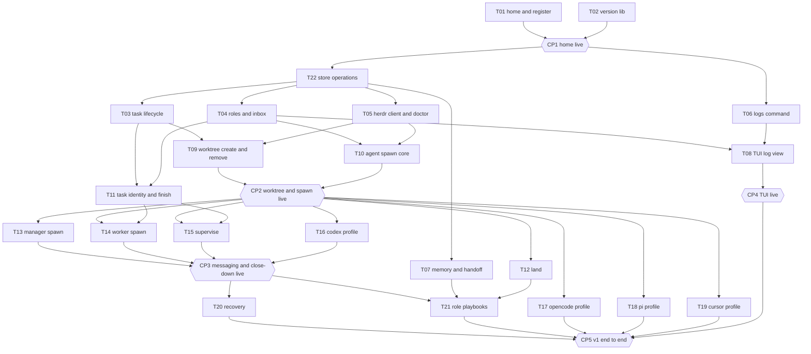

# Tracker

This file is the live record of the hive v1 plan. [tasks/README.md](tasks/README.md)
gives the brief format. [evidence/README.md](evidence/README.md) gives the
evidence format. [03-architecture.md](03-architecture.md) gives the design that
the tasks build. Only the merger edits this file, on `dev`.

## Status values

| Status | Meaning |
| --- | --- |
| blocked | A prerequisite is not landed, or a checkpoint before the task is open. |
| ready | Each prerequisite has the status landed, and each checkpoint before the task passed. A worker can start. |
| in progress | A worker has the task in a worktree. |
| evidence | Each `V<n>.md` exists on the task branch. The verifier can start. |
| verified | `VERIFIED.md` records a pass for each item. The merger can land the task. |
| landed | The task branch is in `dev`. The worktree is gone. |
| skipped | The user skipped the task. The row gives the reason. |

A checkpoint has the status open, passed, or changes requested.

## Waves

| Wave | Tasks | Starts after |
| --- | --- | --- |
| 1 | T01, T02 | The commit of the plan to `dev` |
| 2 | T22, T03, T04, T05, T06, T07 | CP1 and the installed spec |
| 3 | T08, T09, T10, T11 | The prerequisites of each task |
| 4 | T12, T13, T14, T15, T16, T17, T18, T19 | CP2 |
| 5 | T20, T21 | CP3 |

## Graph

A box is a task. A hexagon is a checkpoint. An arrow means "must land, or
pass, before". The graph shows each edge through the nearest checkpoint. The
header of a brief also lists each task that the brief builds on directly.



## Progress

| Task | Title | Wave | Tier | Depends on | Status | Verified by | Landed |
| --- | --- | --- | --- | --- | --- | --- | --- |
| [T01](tasks/T01-home-and-register.md) | home and register | 1 | strong | none | landed | openai-codex/gpt-6.1-sol | 2026-10-18 |
| [T02](tasks/T02-version-lib.md) | version lib | 1 | small | none | landed | opencode-go/deepseek-v4.1-flash | 2026-10-17 |
| [T22](tasks/T22-store-operations.md) | store operations | 2 | strong | T01, CP1 | landed | openai-codex/gpt-6.1-sol | 2026-10-18 |
| [T03](tasks/T03-task-lifecycle.md) | task lifecycle | 2 | decent | T01, T22, CP1 | in progress | | |
| [T04](tasks/T04-roles-and-inbox.md) | roles and inbox | 2 | decent | T01, T22, CP1 | in progress | | |
| [T05](tasks/T05-herdr-client-and-doctor.md) | herdr client and doctor | 2 | strong | T01, T22, CP1 | in progress | | |
| [T06](tasks/T06-logs-command.md) | logs command | 2 | decent | T01, CP1 | landed | openai-codex/gpt-6.1-sol | 2026-10-18 |
| [T07](tasks/T07-memory-and-handoff.md) | memory and handoff | 2 | small | T01, T22, CP1 | ready | | |
| [T08](tasks/T08-tui-log-view.md) | TUI log view | 3 | decent | T04, T06 | blocked | | |
| [T09](tasks/T09-worktree-create-and-remove.md) | worktree create and remove | 3 | decent | T03, T05 | blocked | | |
| [T10](tasks/T10-agent-spawn-core.md) | agent spawn core | 3 | strong | T04, T05 | blocked | | |
| [T11](tasks/T11-task-identity-and-finish.md) | task identity and finish | 3 | small | T03, T04 | blocked | | |
| [T12](tasks/T12-land.md) | land | 4 | decent | T03, T09, CP2 | blocked | | |
| [T13](tasks/T13-manager-spawn.md) | manager spawn | 4 | decent | T10, CP2 | blocked | | |
| [T14](tasks/T14-worker-spawn.md) | worker spawn | 4 | decent | T09, T10, T11, CP2 | blocked | | |
| [T15](tasks/T15-supervise.md) | supervise | 4 | strong | T04, T10, T11, CP2 | blocked | | |
| [T16](tasks/T16-codex-profile.md) | codex profile | 4 | small | T10, CP2 | blocked | | |
| [T17](tasks/T17-opencode-profile.md) | opencode profile | 4 | small | T10, CP2 | blocked | | |
| [T18](tasks/T18-pi-profile.md) | pi profile | 4 | small | T10, CP2 | blocked | | |
| [T19](tasks/T19-cursor-profile.md) | cursor profile | 4 | small | T10, CP2 | blocked | | |
| [T20](tasks/T20-recovery.md) | recovery | 5 | small | T13, T15, CP3 | blocked | | |
| [T21](tasks/T21-role-playbooks.md) | role playbooks | 5 | strong | T07, T12, T13, T14, T15, CP3 | blocked | | |

| Checkpoint | After | Blocks | Status | Date | Verdict by |
| --- | --- | --- | --- | --- | --- |
| CP1 home live | T01, T02 | wave 2 | passed | 2026-10-18 | runner `cp1-run-01.md`. Independent `pi/openai-codex/gpt-6.1-sol:high` `cp1-verify-01.md` |
| CP2 worktree and spawn live | T09, T10 | wave 4 | open | | |
| CP3 messaging and close-down live | T13, T14, T15, T16 | wave 5 | open | | |
| CP4 TUI live | T08 | CP5 | open | | |
| CP5 v1 end to end | T17, T18, T19 landed or skipped, T20, T21, CP4 | the end of v1 | open | | |

## Tiers

| Tier | Use | Bootstrap choice |
| --- | --- | --- |
| strong | Core design, concurrency, the herdr client, the supervisor, the playbooks | pi with `openai-codex/gpt-6-luna` at the thinking level `xhigh` |
| decent | Ordinary command and library work | pi with `openai-codex/gpt-6-luna` at the thinking level `xhigh` |
| small | A move, a profile, a small command | pi with `openai-codex/gpt-6-luna` at the thinking level `xhigh` |
| verifier | Each task | Claude Code with `claude-opus-5-5` for a strong or decent task. pi with `opencode-go/deepseek-v4.1-flash` for a small task. The verifier and the worker are from different model families. |

The dated wave 2 route clarification under Checkpoints replaces this bootstrap
choice for wave 2. It does not change the tier of a task.

## Checkpoints

The user runs each script from the root of the home, on `dev`, after the
merges that the checkpoint names. Each script builds the binary first. A line
of the form `NAME=<...>` means: copy the value from the output of the command
before it. The user then writes the critique into the field. A critique that
changes the design goes into the design file first, then into the briefs that
it affects, with the date. The checkpoint then passes.

The dated clarification below changes these steps.

### Dated procedure clarification: autonomous completion

2026-10-18. The user gave this instruction:

```text
I go to sleep, forget the user presentation demo gates, just complete all of the tasks okay?
```

This clarification changes the checkpoint procedure:

- Routine progress goes in this tracker and in `handoff.md`. Do not wait for a user verdict.
- An automated independent check replaces the user presentation approval for each checkpoint.
- Keep each checkpoint script and each acceptance criterion.
- A checkpoint passes only after its automated independent check passes. Until then, it stays open, and its blocked tasks stay blocked.

### Dated procedure clarification: wave 2 install and routes

2026-10-18. This clarification records the current wave 2 state and routes.

- The corrected spec install precedes code dispatch. The install is one commit on `dev` and follows the corrected plan below `.hive/tmp/coordinator/plans/remaining-v1-r2/`.
- CP1 passed on 2026-10-18. The runner report is `.hive/tmp/coordinator/reports/cp1-run-01.md`. The independent verdict is `.hive/tmp/coordinator/reports/cp1-verify-01.md` from `pi/openai-codex/gpt-6.1-sol:high`. Do not rerun CP1.
- T22 and T06 are ready. T03, T04, T05, and T07 stay blocked on T22.
- Each implementation uses `pi opencode-go/deepseek-v4-flash`. Each independent verifier and each independent spec check uses `pi openai-codex/gpt-6.1-sol:high`. This route replaces the bootstrap choice for wave 2.
- Do not reuse an agent for a later pass. Start at most three external agents beside the coordinator.
- A fresh independent agent checks each concrete implementation brief and each concrete verifier brief before dispatch. The check reports `pass` or `fail` with item IDs. It is not an approval.
- A task worktree branches from a `dev` commit that contains the installed spec and each landed prerequisite. Require the CP1 PASS report separately.
- A pending independent check of the installed spec is not an approval. Do not dispatch code until that check passes.

### Dated correction and preflight gate: wave 2 text correction 02

2026-10-18. This clarification records the correction after the installed-spec
verification `wave2-spec-verify-02.md` returned FAIL on R01 through R08.

- The correction pass is `wave2-spec-fix-prep-02.md`. Its corrected drafts are below `.hive/tmp/coordinator/plans/remaining-v1-r3/`.
- T22 and T06 move from `ready` to `in progress` for preparation only. A worktree exists for each. No implementation started. T03, T04, T05, and T07 stay blocked.
- The approved design is separate from code dispatch. `implementation_allowed` stays false until the installed task and the concrete brief of a task pass their own independent preflight. `implementation_started` stays false.
- A task starts only after its own installed task file and its own concrete implementation brief pass an independent review. Unrelated blocked tasks stay blocked. T22 and T06 are the only tasks in preparation now.
- The route is `pi opencode-go/deepseek-v4-flash:medium` for implementation and `pi openai-codex/gpt-6.1-sol:high` for verification.
- A fresh independent preflight checks the corrected result before any source agent starts. No manual user approval wait applies.
- The `ready` status in the install clarification above is historical. This dated section replaces it.

### Dated progress receipt: wave 2 source implementation and T02 audit

2026-10-18. This section records progress. It changes no task status and no
dependency.

- `wave2-dispatch-preflight-03.md` reports PASS at `840255d3`. The pass covers
the corrected installed text, the current records, the T22 brief, the T06 brief,
and the six verifier templates. It permits only the two checked implementation
payloads. It does not verify code and does not unblock T03, T04, T05, or T07.
- The preflight keeps one planner-only R04 defect open in
`E-spec-edit-checklist.md`. Do not reuse that checklist instruction. The defect
does not block the T22 or T06 dispatch.
- T22 runs in `wA4:p1` as `hive-t22-impl-01` with `pi
opencode-go/deepseek-v4-flash:medium`. The workspace is `wA4`. The terminal is
`term_65e161d77e9db10`. The observed branch tip is `d9b644f7`. The worker report
marker is present. The code is not verified and not landed.
- T06 runs in `wA5:p1` as `hive-t06-impl-01` with the same route. The workspace
is `wA5`. The terminal is `term_65e161da1896e11`. The observed branch tip is
`1c556c33`. The worker report marker is present. The code is not verified and
not landed.
- Each pane reports the agent `pi` with the status `done`. This observation is
not evidence of code success. Test, evidence, and verification status stay pending.
- T03, T04, T05, and T07 remain `blocked` on T22.
- `t02-sol-audit-01.md` reports V1, V2, and V3 PASS at `840255d3` with `pi
openai-codex/gpt-6.1-sol:high`. The audit adds evidence to the T02 record. It
does not replace the original verdict. The T02 row keeps its landing date
`2026-10-17` and its original verifier `opencode-go/deepseek-v4.1-flash`.

### Dated evidence receipt: wave 2 T22 and T06

2026-10-18. This section records the worker evidence for T22 and T06. It
changes only the status of these tasks.

- T22 moves from `in progress` to `evidence`. Branch `task/T22-store-operations`
starts at base `840255d3` and ends at `d9b644f7`. Worktree
`projects/hive/worktrees/T22-store-operations` stays. Pane `wA4:p1` uses terminal
`term_65e161d77e9db10` and route `pi opencode-go/deepseek-v4-flash:medium`.
- T06 moves from `in progress` to `evidence`. Branch `task/T06-logs-command`
starts at base `840255d3` and ends at `1c556c33`. Worktree
`projects/hive/worktrees/T06-logs-command` stays. Pane `wA5:p1` uses terminal
`term_65e161da1896e11` and the same route.
- Evidence `V1` to `V5` exists on the T22 branch. Evidence `V1` to `V4` exists
on the T06 branch. Each file has a commit. No `VERIFIED.md` exists for either
task.
- The coordinator archived the worker reports. T22 archive SHA256
`0d97e7cc418ad7e7706105712824383bb16df02f78ad98e7c1572527422fafcc`. T06 archive
SHA256 `c162692fb75b351e577328942aafc610e06dce9593d5c82a18e3b02af3de35ec`. Each
archive equals its source.
- The state receipt is `.hive/tmp/coordinator/state/wave2-evidence-01.json`.
Independent verification stays pending for both tasks.
- T22 and T06 code is not verified and not landed. T03, T04, T05, and T07 stay
`blocked` on T22. No other status, dependency, or model route changes.

### Dated repair receipt: wave 2 T22 and T06

2026-10-18. This section records the independent verification results. It
changes only the status of these tasks and adds one home check.

- T22 moves from `evidence` to `in progress` for repair. The verifier pass
`t22-verify-01.md` returned FAIL at verification commit `3c14453c`. The checked
worker commit is `d9b644f7`. The path check `t22-path-verify-01.md` returned
FAIL on the same worker commit.
- T22 F1: temporary-name filtering hides directories and links (AC2, AC3). The
walk skips a directory named `.probe.tmp-123`. It also skips a linked collection
in silence.
- T22 F2: the fixed-size tests use the implementation constant. A 2 MiB mutation
keeps the V2 suite green. `generic_test.go:188` to `207` gives the reason.
- T22 path F01: a static `.hive` ancestor link escapes containment. `store.Open`
creates an external state root through the link.
- T22 path F02: `store.Open` accepts a static linked state root. Later operations
reject the same root.
- T06 moves from `evidence` to `in progress` for repair. The verifier pass
`t06-verify-01.md` returned FAIL at verification commit `c9016cf0`. The checked
worker commit is `1c556c33`.
- T06 F1: the line-cap tests use the implementation constant `maxLineBytes`.
- T06 F2: follow does not apply the cutoff to new events.
- T06 F3: follow diagnostics use a relative line number.
- T06 F4: a component newline splits one text event into two physical lines.
- T06 F5: JSON read errors print an envelope on stdout. The brief requires one
plain diagnostic on stderr.
- The coordinator copied the exact tracked `VERIFIED.md` from each worktree. T22
archive `.hive/tmp/coordinator/reports/t22-verify-01-archive.md` has 25467 bytes
and SHA256 `7c2d54f583a17c013ce09409786a0269bd0238d3d4e3b4b7cad3a2749325a464`.
T06 archive `.hive/tmp/coordinator/reports/t06-verify-01-archive.md` has 75031
bytes and SHA256
`ca9a28c9ef062589a2e2160f53cf264095e336adb90b6bf28285b41337cb42b5`. Each archive
equals its source.
- Repair agents `hive-t22-fix-01` and `hive-t06-fix-01` run with `pi
opencode-go/deepseek-v4-flash:medium`. Both panes reported the status `working`
at 2026-10-18 01:30 EDT. Repair commits `d8155e5c` and `dc7964cb` exist at
01:32 EDT. No repair report or repair verification exists.
- A bounded static-link check finds a home gap before logger start. With `H/.hive`
as a link to an external directory that holds a regular `README.md`, `hive
--home H project list` exits 0. That command writes `logs/2026-10-18.jsonl` and
`state/` below the external directory. `home.Resolve` accepts the link because
`os.Lstat` follows the `.hive` parent. `cmd/common` then calls `log.Open`, and
the store opens the same way. Both call `os.MkdirAll` below `.hive` with no type
check.
- Recommendation: T01 owns a static `.hive` type check in `home.Resolve` and the
logger start path. T22 keeps its store root check.
- T22 and T06 code is not verified and not landed. T03, T04, T05, and T07 stay
`blocked` on T22. No other status, dependency, or model route changes.

### Dated verification receipt: wave 2 T22 and T06

2026-10-18. This section records the independent verification of T22 and T06. It
changes only the status of these tasks.

- T22 moves from `in progress` to `verified`. Branch `task/T22-store-operations`
has base `840255d3`. The tested worker commit is `a3fea5a4`. The verification
commit is `0217df27`. Its parent is `a3fea5a4`. Its only change is
`spec/hive-v1/evidence/T22-store-operations/VERIFIED.md`.
- T06 moves from `in progress` to `verified`. Branch `task/T06-logs-command` has
base `840255d3`. The tested worker commit is `ce9b992b`. The verification
commit is `b8006a86`. Its parent is `ce9b992b`. Its only change is
`spec/hive-v1/evidence/T06-logs-command/VERIFIED.md`.
- Each verifier ran `pi openai-codex/gpt-6.1-sol:high`. These are the actual
provider, model, and level from the `PI_*` values. The route matches the dated
wave 2 route.
- The T22 report is `.hive/tmp/coordinator/reports/t22-verify-02.md`. Its last
line is `END VERIFIER T22-store-operations t22-verify-02`. V1 to V5 are PASS.
- The T06 report is `.hive/tmp/coordinator/reports/t06-verify-02.md`. Its last
line is `END VERIFIER T06-logs-command t06-verify-02`. V1 to V4 are PASS.
- Each `VERIFIED.md` keeps its earlier FAIL sections as history. The latest
dated section in each file is PASS.
- Both remote task branches equal their local verification commits. Both task
worktrees are clean.
- The coordinator copied the worker fix reports to
`.hive/tmp/coordinator/reports/t22-fix-01-archive.md` and
`.hive/tmp/coordinator/reports/t06-fix-01-archive.md`. Each copy equals its
source.
- T22 and T06 stay `verified` and not landed. T03, T04, T05, and T07 stay
`blocked` on T22. No other status, dependency, or model route changes.

### Dated landing receipt: wave 2 T22 and T06

2026-10-18. This section records the landing of T22 and T06 on `dev`. It changes
only the status of these tasks.

- The merger landed `task/T22-store-operations` first at verification commit
`0217df27`. The merge commit is `0d0c9d4e`. The subject is `merge(T22): land
store operations`.
- The merger landed `task/T06-logs-command` second at verification commit
`b8006a86`. The merge commit is `84da9819`. The subject is `merge(T06): land
logs command`.
- Both merges used `--no-ff`. Neither merge had a conflict.
- The combined root passes the gate. `gofmt -l` prints nothing. `go vet ./...`
exits 0. `golangci-lint run --allow-serial-runners ./...` reports `0 issues.`
`go test -race -count=1 ./...` passes each package.
- Each task-owned source path and evidence path in `dev` equals its verification
tip. The shared `cmd/root.go` has only the T06 import line and the T06
registration line.
- The push reached `origin/dev` at `84da9819` without force.
- The coordinator archived the full T22 worktree at
`.hive/tmp/coordinator/archives/T22-0217df27/`. It archived the full T06 worktree
at `.hive/tmp/coordinator/archives/T06-b8006a86/`. Each archive excludes the
`.git` pointer file. Each archive manifest equals the original manifest.
- `herdr worktree remove --workspace wA4` removed workspace `wA4`, pane
`wA4:p1`, terminal `term_65e161d77e9db10`, and the T22 worktree.
`herdr worktree remove --workspace wA5` removed workspace `wA5`, pane `wA5:p1`,
terminal `term_65e161da1896e11`, and the T06 worktree. Neither command used
force.
- Both branches `task/T22-store-operations` and `task/T06-logs-command` stay at
their verification commits, local and remote.
- The hive workspace `w9X` and the T01 follow-up workspace `wA6` stay.
- The T22 and T06 rows show `landed` with verifier `openai-codex/gpt-6.1-sol`
and date `2026-10-18`.
- T03, T04, T05, and T07 move from `blocked` to `ready`. Each prerequisite is
landed and CP1 passed.
- T08 stays `blocked` on T04.
- No other status, dependency, or model route changes.

### Dated dispatch receipt: wave 2 next track

2026-10-18. This section records the dispatch of T03 and T04. It records the
preparation of T05 and T07. It corrects three old record items. It changes only
the T03, T04, and T05 status. It accepts no task source.

- The independent root code integration check passes at `af3e5f69`.
  `.hive/tmp/coordinator/reports/t01-home-and-wave2-verify-01.md` gives PASS in
  its `B integration` section and ends with `END T01 HOME AND WAVE2 VERIFY 01`.
  That pass covers the root integration. It is not a source acceptance.
- `.hive/tmp/coordinator/reports/wave2-next-preflight-01.md` gives one contract
  PASS for each of the four payloads `t03-impl-01`, `t04-impl-01`,
  `t05-impl-01`, and `t07-impl-01`. Its last line is
  `END WAVE2 NEXT PREFLIGHT 01`. A contract PASS checks a brief only. Do not read
  it as a source PASS.
- The coordinator saved the four checked payloads below
  `.hive/tmp/coordinator/briefs/` with exact bytes:
  - `t03-impl-01.md` has 12242 bytes and SHA256
    `b83c479d47556c4029dfd4d7f707925979f9e054b4a0d8607ec43fd39d5d5737`.
  - `t04-impl-01.md` has 17247 bytes and SHA256
    `e6d6d2fddb5b4511573fc2d112ef3d1877b44391372972f24abf126dc5b6957e`.
  - `t05-impl-01.md` has 12053 bytes and SHA256
    `4c2d1d383e72057e0b05a5a0f5a7034b86a97fc8ebd93fb2626f4bd2495489f4`.
  - `t07-impl-01.md` has 13409 bytes and SHA256
    `67e71c864906827a96a348f69aec3ba6fb6b7146faf83c5a358ce59394e2741c`.
- T03 moves from `ready` to `in progress`. Branch `task/T03-task-lifecycle` and
  worktree `projects/hive/worktrees/T03-task-lifecycle` have base `84da9819`.
  Agent `hive-t03-impl-01` runs with the route
  `pi opencode-go/deepseek-v4-flash:medium` in workspace `wA7`, pane `wA7:p1`.
- T04 moves from `ready` to `in progress`. Branch `task/T04-roles-and-inbox` and
  worktree `projects/hive/worktrees/T04-roles-and-inbox` have base `84da9819`.
  Agent `hive-t04-impl-01` runs with the same route in workspace `wA8`, pane
  `wA8:p1`.
- T05 moves from `ready` to `in progress` for preparation only. Branch
  `task/T05-herdr-client-and-doctor` and worktree
  `projects/hive/worktrees/T05-herdr-client-and-doctor` have base `84da9819`.
  Workspace `wA9` and pane `wA9:p1` exist. No agent runs in that pane.
  `implementation_allowed` is true. `implementation_started` is false. Agent
  `hive-t05-impl-01` is pending.
- T07 stays `ready`. Branch `task/T07-memory-and-handoff` and worktree
  `projects/hive/worktrees/T07-memory-and-handoff` have base `84da9819`.
  Workspace `wAA` and pane `wAA:p1` exist. No agent runs in that pane. The
  coordinator prepares the task and queues it. The task does not run.
- Each implementation route is `pi opencode-go/deepseek-v4-flash:medium`. The
  observed thinking level is `high`. The brief names `medium`. The two values
  agree with the dated wave 2 route. Each future verifier uses a fresh
  `pi openai-codex/gpt-6.1-sol:high` agent.
- `herdr agent list` reports the status `working` for `hive-t03-impl-01` and
  `hive-t04-impl-01`. This observation is not evidence of source success. Test,
  evidence, and verification status stay pending.

### Dated correction receipt: wave 2 records R01, R02, and B01

2026-10-18. This section corrects three record items. It keeps each original
report. It changes no task status and no dependency.

- R01: `wave2-repair-prep-01.md` and its state record said that the final 12580
  bytes differ from the historical section. The two selections are equal. The
  final 12580 bytes equal the bytes after the historical marker. Each selection
  has SHA256
  `0c0d843ff49e0e6d8efc60425630ea2183b1f9c0ca5aecb8d53a29c035a1bd69`. The
  historical text did not change.
- R02: the absent saved brief did not prove that no check ran. The coordinator
  records a fresh no-tools `pi openai-codex/gpt-6.1-sol:high` check before the
  past dispatch. Its results were T22 PASS, T06 PASS, and ROOT PASS. No
  independent inspection of that in-memory check occurred. The field
  `checked_repair_brief_found: false` stays as a dated file-discovery snapshot.
- The four new saved briefs above are current evidence. They do not change the
  old transcript.
- B01: `wave2-land-01.md:20` and its state record gave remote `main` as local
  `main`. The actual local `main` is
  `3692162633f896b8fee6197469adba91f666a00c`. `origin/main` and the direct
  remote `main` are `928cfa95e0906315fcb4a65a5cdbdef1470a0503`. Each value
  stayed unchanged. The local `main` reflog shows its last change on
  2026-08-20. Do not move a `main` reference to make an old record true.
- The combined records verdict stays FAIL on B01. The code integration verdict
  is PASS. Keep the two verdicts separate.

### CP1 home live

After T01 and T02. Blocks wave 2.

```sh
go build . && ./hive version
./hive project register . --base dev
./hive project list
./hive project show hive --json
./hive --home /tmp/not-a-home project list
echo "exit $?"
tail -n 3 .hive/logs/"$(date +%F)".jsonl
```

Look for: one effect line for each directory and the record, a readable JSON
envelope, the error line for the false home with exit status 1, and JSON log
events with `component`, `command`, and `duration_ms`.

Critique:

Automated. The independent verdict is `cp1-verify-01.md` from `pi/openai-codex/gpt-6.1-sol:high`. The runner report is `cp1-run-01.md`. No user presentation approval applies.

### CP2 worktree and spawn live

After T09 and T10. Blocks wave 4.

```sh
go build .
./hive task create --project hive --title "checkpoint two"
TASK=<task ID from the output>
./hive worktree create --task "$TASK"
PANE=<root pane from the output>
./hive agent spawn --pane "$PANE" --role worker --project hive --task "$TASK" \
  --harness claude --model <small model> --name cp2-worker
./hive agent send --agent cp2-worker --wait "Reply with the word pong."
./hive agent list
./hive agent stop --agent cp2-worker
herdr workspace list
./hive task cancel --task "$TASK"
./hive worktree remove --task "$TASK"
herdr workspace list
git branch --list "task/$TASK"
```

Look for: a workspace with the task ID as its label beside the hive workspace,
with one tab and the agent in its root pane. No tab shows an empty shell. The
word pong appears in the pane. The list shows the agent as live. After the stop,
the workspace of the task is gone and the record is `stopped`. After the remove,
the directory is gone and the branch stays.

Critique:

### CP3 messaging and close-down live

After T13, T14, T15, and T16. Blocks wave 5.

Use two panes of the hive session. Pane A is your pane in the hive workspace.
Pane B runs the supervisor. First, the manager workspace:

```sh
go build .
./hive agent spawn --role manager --project hive --harness claude --model <small model>
./hive agent list
./hive agent stop --agent manager-hive
herdr workspace list
```

Look for: the workspace `hive:hive` with the manager in the root pane of its
first tab, and no empty tab. After the stop, the workspace is gone.

Then take the manager role in pane A, and start the supervisor in pane B:

```sh
./hive agent register --role manager --project hive     # pane A
./hive supervise                                        # pane B
```

Then, in pane A:

```sh
HIVE=$PWD
./hive task create --project hive --title "checkpoint three"
TASK=<task ID from the output>
./hive worktree create --task "$TASK"
./hive agent spawn --role worker --task "$TASK" --harness claude --model <small model>
WORKER=<agent name from the output>
./hive agent send --agent "$WORKER" "Run this command, then wait: $HIVE/hive --home $HIVE task complete --task $TASK"
./hive inbox
```

Watch: an inbox record `completed` appears, one nudge line arrives in pane A,
and the supervisor stops the worker when it is idle. The workspace of the
worktree is then gone. Then:

```sh
./hive agent spawn --role verifier --task "$TASK" --harness codex
VERIFIER=<agent name from the output>
./hive agent send --agent "$VERIFIER" "Run this command, then wait: $HIVE/hive --home $HIVE task verify --task $TASK"
./hive inbox
./hive agent list --all
./hive worktree remove --task "$TASK"
```

Watch: the verifier spawn reopens the worktree as a workspace, then the
record `verified`, the nudge, and the stop of the verifier. Then
press Ctrl-C in pane B. The supervisor exits with status 0, and `./hive doctor`
in pane A reports the supervisor claim as stale.

Critique:

### CP4 TUI live

After T08. Blocks CP5.

```sh
go build .
./hive
```

Run it in a pane of the hive session. Press `/`, type `project`, and press
Enter. Then press `l`, `f`, `g`, `G`, Escape, and `q`. Look for: the header
shows the home path, the supervisor state, the live agent count, and the unread
inbox count. The body follows the log file live. The filter narrows the lines
and Escape clears it.

Critique:

### CP5 v1 end to end

After T17, T18, T19 landed or skipped, T20, T21, and CP4. The end of v1. This
checkpoint shows the definition of v1: hive builds hive through a manager, a
worker, a verifier, and a landing.

Before the run, write a grant for merge and push to `dev` into
`projects/hive/overrides/grants.md`. Use three panes of the hive session. Pane
A is your pane. Pane B runs `./hive supervise`. Pane C runs `./hive`.

```sh
go build .
./hive doctor
./hive agent spawn --role manager --project hive --harness claude --model <strong model>
./hive agent send --agent manager-hive "Create one task that adds the file reference/dogfood/cp5.md with the date of this run. Run it with a worker, verify it with a verifier, and land it with mode merge. Then write your handoff."
```

Watch in pane C and with `./hive inbox`, `./hive task list`, and
`./hive agent list`: the workspace `hive:hive` with the manager in the first
tab, a worktree workspace for the task, a worker and then a verifier in it,
inbox records for each step, and log events for each. When the inbox shows the
landing:

```sh
git log --oneline -3
./hive agent stop --agent manager-hive
./hive doctor
herdr workspace list
```

Look for: a merge commit on `dev` with the new file, the worktree gone, the
workspace `hive:hive` gone after the stop, and a clean `doctor`. Decide at this
checkpoint if the bootstrap clause in `AGENTS.md` ends. The clause ends when the
hive manager spawned its first worker.

Critique:

## Procedures

### Before the first task

1. The developer commits the plan on `dev` and pushes `dev`: `AGENTS.md`, `STE-GLOSSARY.md`, `.gitignore`, `.hive/README.md`, `gitignore_test.go`, `ste_test.go`, `testdata/`, `spec/`, and `reference/dogfood/`. A worktree branches from `dev` and needs these files.
2. Run the gate on `dev`. It must pass.

### Start a task

The merger starts a task whose status is ready.

1. Set the status to in progress in the progress table. Commit on `dev` and push `dev`.
2. From a pane of the hive workspace, make the worktree:

```sh
HIVE=/home/penguin/source/hive
herdr worktree create --cwd "$HIVE" --branch task/<task-id> --base dev \
  --path "$HIVE/projects/hive/worktrees/<task-id>" --label <task-id>
```

3. Start the harness of the tier in the root pane of the new workspace, with `herdr agent start` or by hand.
4. Give the worker this first prompt, with the values filled in:

```text
You are a worker on the hive project. Your home is /home/penguin/source/hive.
Your worktree is /home/penguin/source/hive/projects/hive/worktrees/<task-id>, on the
branch task/<task-id>. Read AGENTS.md. Your brief is spec/hive-v1/tasks/<task-id>.md.
Follow the worker flow in spec/hive-v1/05-tracker.md. Do not edit the tracker.
```

### Worker flow

1. Read `AGENTS.md`, the brief, and `evidence/README.md`.
2. For each acceptance criterion: write the failing test, run it, record the red run, write the code, run it, record the green run. Commit after each green run.
3. Build the binary with `go build .` before each live check. Close each herdr workspace, tab, and agent that the check made.
4. Write each `V<n>.md` into `spec/hive-v1/evidence/<task-id>/`.
5. Run the gate from the root of the worktree. Record it as the last item. Commit the evidence.
6. Each commit goes on the task branch with a subject of the form `type(scope): summary`. Push the branch after each commit with `git push -u origin task/<task-id>`. Do not wait for a request from the user. Never commit on `dev` or `main`.
7. Tell the user in your pane that the evidence is complete. A spec task has no hive task record during the bootstrap, so `hive task complete` does not apply.

### Verifier flow

The merger sets the status to evidence and starts the verifier in the same
pane after the worker stops. The verifier is from another model family.

1. Read `AGENTS.md`, the brief, `evidence/README.md`, and each `V<n>.md`.
2. Prepare an isolated home for each transcript and probe. Make a unique temporary directory. Create its marker `.hive/README.md` explicitly. Pass its absolute path with `--home`. Make a unique temporary project where a test needs Git. Do not remove the worktree `.hive/state`, `.hive/logs`, or `.hive/tmp`. The worker report lives in `.hive/tmp`, so keep it. Remove only the unique fixture that the pass made. Then run `go build .`.
3. Run each verification item again. Compare the output with the expected output of the brief.
4. Write `VERIFIED.md`, commit it on the task branch, and push the branch.
5. On a fail, the merger starts the worker again in the same pane with the fail remarks. The worker corrects, the verifier runs again.

### Land a task

The merger lands a task whose `VERIFIED.md` records a pass for each item.

```sh
cd /home/penguin/source/hive
git branch --show-current       # must print dev
git status --porcelain          # must print nothing
git merge --no-ff --no-commit task/<task-id>
test -z "$(gofmt -l $(git ls-files -co --exclude-standard '*.go'))"
go vet ./...
golangci-lint run ./...
go test -race ./...
git commit -m "merge(<task-id>): land <title>"
git push origin dev
herdr worktree remove --workspace <workspace of the worktree>
```

Each command must exit 0 before the next one runs. The `test` line fails when
`gofmt -l` prints a file. A merge conflict in a file of the shared files table
gets a resolution that keeps each line. For any other conflict, or for a gate
failure, run `git merge --abort`, keep the worktree, and send the output to the
worker. The worker merges `dev` into its branch and corrects. The landing then
starts again.

After the push, set the row to landed, with the verifier model and the date.
Set each task whose prerequisites are now landed to ready, unless a checkpoint
before it is open. Commit on `dev` as `docs(tracker): land <task-id>` and push
`dev`. The branch stays.

### Pass a checkpoint

The dated clarification under Checkpoints changes this procedure.

1. When each input of the checkpoint has the status landed, or skipped where the table allows it, run its script.
2. Write the critique into the field of the checkpoint, with the date.
3. Decide: passed, or changes requested.
4. For changes requested: write the change into the design file, then into the "Changes" section of each affected brief. Set each affected task to in progress and start a worker on it, in its worktree when it still exists, else in a new one. The checkpoint stays open until those tasks land again and the script runs again.
5. For passed: set the checkpoint to passed. Set each task that it blocked to ready when each other prerequisite of that task has the status landed. Commit on `dev` and push `dev`.

### Shared files

Each task owns the folders that its brief names. These files take one line for
each task, so that two tasks can edit them in parallel:

| File | Rule |
| --- | --- |
| `cmd/root.go` | One `AddCommand` line for each command, plus the import lines that the registrations need. T04 and T07 each register two commands. |
| `doc.go` of a shared package | One map line for each new file. |
| `internal/lib/harness/registry.go` | One registry line for each profile. |
| `internal/doctor/checks.go` | One check line for each check. |
| `internal/agent/spawn.go` | One case line for each role in the pane-choice switch. |
| `internal/lib/records/*.go` | One field line for each task, at the end of the struct. |
| `ste_test.go` | One `steFiles` line for each new instruction file. |
| `testdata/ste-baseline.json` | One entry of 0 for each new instruction file. |

The merger resolves a conflict in these files by keeping each line. After a
conflicting merge, the merger runs the gate again before the commit.

### Skip a task

The user can skip T19 when the Cursor agent has no quota. The merger sets the
status to skipped with the reason. CP5 does not wait for a skipped task.
