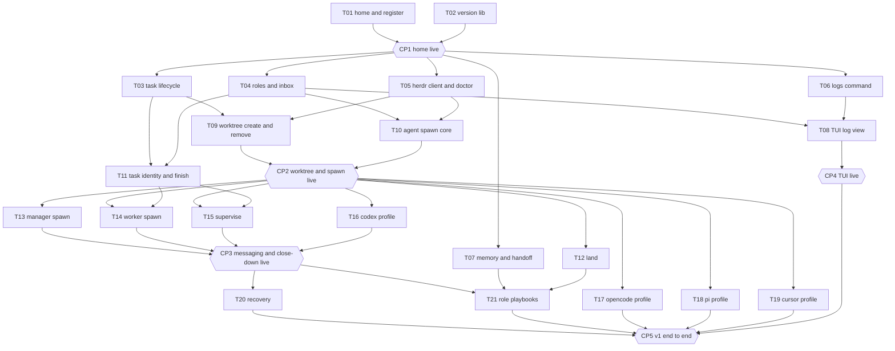

# Tracker

This file is the live record of the hive v1 plan. [tasks/README.md](tasks/README.md)
gives the brief format. [evidence/README.md](evidence/README.md) gives the
evidence format. [03-architecture.md](03-architecture.md) gives the design that
the tasks build. Only the merger edits this file, on `dev`.

## Status values

| Status | Meaning |
| --- | --- |
| blocked | A prerequisite is not landed, or a checkpoint before the task is open. |
| ready | Each prerequisite has the status landed, and each checkpoint before the task passed. A worker can start. |
| in progress | A worker has the task in a worktree. |
| evidence | Each `V<n>.md` exists on the task branch. The verifier can start. |
| verified | `VERIFIED.md` records a pass for each item. The merger can land the task. |
| landed | The task branch is in `dev`. The worktree is gone. |
| skipped | The user skipped the task. The row gives the reason. |

A checkpoint has the status open, passed, or changes requested.

## Waves

| Wave | Tasks | Starts after |
| --- | --- | --- |
| 1 | T01, T02 | The commit of the plan to `dev` |
| 2 | T03, T04, T05, T06, T07 | CP1 |
| 3 | T08, T09, T10, T11 | The prerequisites of each task |
| 4 | T12, T13, T14, T15, T16, T17, T18, T19 | CP2 |
| 5 | T20, T21 | CP3 |

## Graph

A box is a task. A hexagon is a checkpoint. An arrow means "must land, or
pass, before". The graph shows each edge through the nearest checkpoint. The
header of a brief also lists each task that the brief builds on directly.



## Progress

| Task | Title | Wave | Tier | Depends on | Status | Verified by | Landed |
| --- | --- | --- | --- | --- | --- | --- | --- |
| [T01](tasks/T01-home-and-register.md) | home and register | 1 | strong | none | ready | | |
| [T02](tasks/T02-version-lib.md) | version lib | 1 | small | none | ready | | |
| [T03](tasks/T03-task-lifecycle.md) | task lifecycle | 2 | decent | T01, CP1 | blocked | | |
| [T04](tasks/T04-roles-and-inbox.md) | roles and inbox | 2 | decent | T01, CP1 | blocked | | |
| [T05](tasks/T05-herdr-client-and-doctor.md) | herdr client and doctor | 2 | strong | T01, CP1 | blocked | | |
| [T06](tasks/T06-logs-command.md) | logs command | 2 | decent | T01, CP1 | blocked | | |
| [T07](tasks/T07-memory-and-handoff.md) | memory and handoff | 2 | small | T01, CP1 | blocked | | |
| [T08](tasks/T08-tui-log-view.md) | TUI log view | 3 | decent | T04, T06 | blocked | | |
| [T09](tasks/T09-worktree-create-and-remove.md) | worktree create and remove | 3 | decent | T03, T05 | blocked | | |
| [T10](tasks/T10-agent-spawn-core.md) | agent spawn core | 3 | strong | T04, T05 | blocked | | |
| [T11](tasks/T11-task-identity-and-finish.md) | task identity and finish | 3 | small | T03, T04 | blocked | | |
| [T12](tasks/T12-land.md) | land | 4 | decent | T03, T09, CP2 | blocked | | |
| [T13](tasks/T13-manager-spawn.md) | manager spawn | 4 | decent | T10, CP2 | blocked | | |
| [T14](tasks/T14-worker-spawn.md) | worker spawn | 4 | decent | T09, T10, T11, CP2 | blocked | | |
| [T15](tasks/T15-supervise.md) | supervise | 4 | strong | T04, T10, T11, CP2 | blocked | | |
| [T16](tasks/T16-codex-profile.md) | codex profile | 4 | small | T10, CP2 | blocked | | |
| [T17](tasks/T17-opencode-profile.md) | opencode profile | 4 | small | T10, CP2 | blocked | | |
| [T18](tasks/T18-pi-profile.md) | pi profile | 4 | small | T10, CP2 | blocked | | |
| [T19](tasks/T19-cursor-profile.md) | cursor profile | 4 | small | T10, CP2 | blocked | | |
| [T20](tasks/T20-recovery.md) | recovery | 5 | small | T13, T15, CP3 | blocked | | |
| [T21](tasks/T21-role-playbooks.md) | role playbooks | 5 | strong | T07, T12, T13, T14, T15, CP3 | blocked | | |

| Checkpoint | After | Blocks | Status | Date |
| --- | --- | --- | --- | --- |
| CP1 home live | T01, T02 | wave 2 | open | |
| CP2 worktree and spawn live | T09, T10 | wave 4 | open | |
| CP3 messaging and close-down live | T13, T14, T15, T16 | wave 5 | open | |
| CP4 TUI live | T08 | CP5 | open | |
| CP5 v1 end to end | T17, T18, T19 landed or skipped, T20, T21, CP4 | the end of v1 | open | |

## Tiers

| Tier | Use | Bootstrap choice |
| --- | --- | --- |
| strong | Core design, concurrency, the herdr client, the supervisor, the playbooks | The strongest Claude model that the user has |
| decent | Ordinary command and library work | A mid Claude model |
| small | A move, a profile, a small command | The small Claude model |
| verifier | Each task | Codex with `gpt-6.1-sol`, so that the verifier is from another model family |

## Checkpoints

The user runs each script from the root of the home, on `dev`, after the
merges that the checkpoint names. Each script builds the binary first. A line
of the form `NAME=<...>` means: copy the value from the output of the command
before it. The user then writes the critique into the field. A critique that
changes the design goes into the design file first, then into the briefs that
it affects, with the date. The checkpoint then passes.

### CP1 home live

After T01 and T02. Blocks wave 2.

```sh
go build . && ./hive version
./hive project register . --base dev
./hive project list
./hive project show hive --json
./hive --home /tmp/not-a-home project list
echo "exit $?"
tail -n 3 .hive/logs/"$(date +%F)".jsonl
```

Look for: one effect line for each directory and the record, a readable JSON
envelope, the error line for the false home with exit status 1, and JSON log
events with `component`, `command`, and `duration_ms`.

Critique:

### CP2 worktree and spawn live

After T09 and T10. Blocks wave 4.

```sh
go build .
./hive task create --project hive --title "checkpoint two"
TASK=<task ID from the output>
./hive worktree create --task "$TASK"
PANE=<root pane from the output>
./hive agent spawn --pane "$PANE" --role worker --project hive --task "$TASK" \
  --harness claude --model <small model> --name cp2-worker
./hive agent send --agent cp2-worker --wait "Reply with the word pong."
./hive agent list
./hive agent stop --agent cp2-worker
herdr pane read "$PANE" --lines 5
./hive task cancel --task "$TASK"
./hive worktree remove --task "$TASK"
herdr workspace list
git branch --list "task/$TASK"
```

Look for: a workspace with the task ID as its label beside the hive workspace,
with one tab and the agent in its root pane. No tab shows an empty shell. The
word pong appears in the pane. The list shows the agent as live. After the stop,
the pane shows a shell prompt and the record is `stopped`. After the remove, the
workspace and the directory are gone and the branch stays.

Critique:

### CP3 messaging and close-down live

After T13, T14, T15, and T16. Blocks wave 5.

Use two panes of the hive session. Pane A is your pane in the hive workspace.
Pane B runs the supervisor. First, the manager workspace:

```sh
go build .
./hive agent spawn --role manager --project hive --harness claude --model <small model>
./hive agent list
./hive agent stop --agent manager-hive
herdr workspace list
```

Look for: the workspace `hive:hive` with the manager in the root pane of its
first tab, and no empty tab. After the stop, the workspace is gone.

Then take the manager role in pane A, and start the supervisor in pane B:

```sh
./hive agent register --role manager --project hive     # pane A
./hive supervise                                        # pane B
```

Then, in pane A:

```sh
HIVE=$PWD
./hive task create --project hive --title "checkpoint three"
TASK=<task ID from the output>
./hive worktree create --task "$TASK"
./hive agent spawn --role worker --task "$TASK" --harness claude --model <small model>
WORKER=<agent name from the output>
./hive agent send --agent "$WORKER" "Run this command, then wait: $HIVE/hive --home $HIVE task complete --task $TASK"
./hive inbox
```

Watch: an inbox record `completed` appears, one nudge line arrives in pane A,
and the supervisor stops the worker when it is idle. The worktree pane then
shows a shell prompt. Then:

```sh
./hive agent spawn --role verifier --task "$TASK" --harness codex
VERIFIER=<agent name from the output>
./hive agent send --agent "$VERIFIER" "Run this command, then wait: $HIVE/hive --home $HIVE task verify --task $TASK"
./hive inbox
./hive agent list --all
./hive worktree remove --task "$TASK"
```

Watch: the record `verified`, the nudge, and the stop of the verifier. Then
press Ctrl-C in pane B. The supervisor exits with status 0, and `./hive doctor`
in pane A reports the supervisor claim as stale.

Critique:

### CP4 TUI live

After T08. Blocks CP5.

```sh
go build .
./hive
```

Run it in a pane of the hive session. Press `/`, type `project`, and press
Enter. Then press `l`, `f`, `g`, `G`, Escape, and `q`. Look for: the header
shows the home path, the supervisor state, the live agent count, and the unread
inbox count. The body follows the log file live. The filter narrows the lines
and Escape clears it.

Critique:

### CP5 v1 end to end

After T17, T18, T19 landed or skipped, T20, T21, and CP4. The end of v1. This
checkpoint shows the definition of v1: hive builds hive through a manager, a
worker, a verifier, and a landing.

Before the run, write a grant for merge and push to `dev` into
`projects/hive/overrides/grants.md`. Use three panes of the hive session. Pane
A is your pane. Pane B runs `./hive supervise`. Pane C runs `./hive`.

```sh
go build .
./hive doctor
./hive agent spawn --role manager --project hive --harness claude --model <strong model>
./hive agent send --agent manager-hive "Create one task that adds the file reference/dogfood/cp5.md with the date of this run. Run it with a worker, verify it with a verifier, and land it with mode merge. Then write your handoff."
```

Watch in pane C and with `./hive inbox`, `./hive task list`, and
`./hive agent list`: the workspace `hive:hive` with the manager in the first
tab, a worktree workspace for the task, a worker and then a verifier in it,
inbox records for each step, and log events for each. When the inbox shows the
landing:

```sh
git log --oneline -3
./hive agent stop --agent manager-hive
./hive doctor
herdr workspace list
```

Look for: a merge commit on `dev` with the new file, the worktree gone, the
workspace `hive:hive` gone after the stop, and a clean `doctor`. Decide at this
checkpoint if the bootstrap clause in `AGENTS.md` ends. The clause ends when the
hive manager spawned its first worker.

Critique:

## Procedures

### Before the first task

1. The developer commits the plan on `dev` and pushes `dev`: `AGENTS.md`, `STE-GLOSSARY.md`, `.gitignore`, `.hive/README.md`, `gitignore_test.go`, `ste_test.go`, `testdata/`, `spec/`, and `reference/dogfood/`. A worktree branches from `dev` and needs these files.
2. Run the gate on `dev`. It must pass.

### Start a task

The merger starts a task whose status is ready.

1. Set the status to in progress in the progress table. Commit on `dev` and push `dev`.
2. From a pane of the hive workspace, make the worktree:

```sh
HIVE=/home/penguin/source/hive
herdr worktree create --cwd "$HIVE" --branch task/<task-id> --base dev \
  --path "$HIVE/projects/hive/worktrees/<task-id>" --label <task-id>
```

3. Start the harness of the tier in the root pane of the new workspace, with `herdr agent start` or by hand.
4. Give the worker this first prompt, with the values filled in:

```text
You are a worker on the hive project. Your home is /home/penguin/source/hive.
Your worktree is /home/penguin/source/hive/projects/hive/worktrees/<task-id>, on the
branch task/<task-id>. Read AGENTS.md. Your brief is spec/hive-v1/tasks/<task-id>.md.
Follow the worker flow in spec/hive-v1/05-tracker.md. Do not edit the tracker.
```

### Worker flow

1. Read `AGENTS.md`, the brief, and `evidence/README.md`.
2. For each acceptance criterion: write the failing test, run it, record the red run, write the code, run it, record the green run. Commit after each green run.
3. Build the binary with `go build .` before each live check. Close each herdr workspace, tab, and agent that the check made.
4. Write each `V<n>.md` into `spec/hive-v1/evidence/<task-id>/`.
5. Run the gate from the root of the worktree. Record it as the last item. Commit the evidence.
6. Each commit goes on the task branch with a subject of the form `type(scope): summary`. Push the branch after each commit with `git push -u origin task/<task-id>`. Do not wait for a request from the user. Never commit on `dev` or `main`.
7. Tell the user in your pane that the evidence is complete. A spec task has no hive task record during the bootstrap, so `hive task complete` does not apply.

### Verifier flow

The merger sets the status to evidence and starts the verifier in the same
pane after the worker stops. The verifier is from another model family.

1. Read `AGENTS.md`, the brief, `evidence/README.md`, and each `V<n>.md`.
2. Remove the runtime data of the worktree, so that each run starts clean: `rm -rf .hive/state .hive/logs .hive/tmp` from the root of the worktree. Then run `go build .`.
3. Run each verification item again. Compare the output with the expected output of the brief.
4. Write `VERIFIED.md`, commit it on the task branch, and push the branch.
5. On a fail, the merger starts the worker again in the same pane with the fail remarks. The worker corrects, the verifier runs again.

### Land a task

The merger lands a task whose `VERIFIED.md` records a pass for each item.

```sh
cd /home/penguin/source/hive
git branch --show-current       # must print dev
git status --porcelain          # must print nothing
git merge --no-ff --no-commit task/<task-id>
test -z "$(gofmt -l $(git ls-files -co --exclude-standard '*.go'))"
go vet ./...
golangci-lint run ./...
go test -race ./...
git commit -m "merge(<task-id>): land <title>"
git push origin dev
herdr worktree remove --workspace <workspace of the worktree>
```

Each command must exit 0 before the next one runs. The `test` line fails when
`gofmt -l` prints a file. A merge conflict in a file of the shared files table
gets a resolution that keeps each line. For any other conflict, or for a gate
failure, run `git merge --abort`, keep the worktree, and send the output to the
worker. The worker merges `dev` into its branch and corrects. The landing then
starts again.

After the push, set the row to landed, with the verifier model and the date.
Set each task whose prerequisites are now landed to ready, unless a checkpoint
before it is open. Commit on `dev` as `docs(tracker): land <task-id>` and push
`dev`. The branch stays.

### Pass a checkpoint

1. When each input of the checkpoint has the status landed, or skipped where the table allows it, run its script.
2. Write the critique into the field of the checkpoint, with the date.
3. Decide: passed, or changes requested.
4. For changes requested: write the change into the design file, then into the "Changes" section of each affected brief. Set each affected task to in progress and start a worker on it, in its worktree when it still exists, else in a new one. The checkpoint stays open until those tasks land again and the script runs again.
5. For passed: set the checkpoint to passed. Set each task that it blocked to ready when each other prerequisite of that task has the status landed. Commit on `dev` and push `dev`.

### Shared files

Each task owns the folders that its brief names. These files take one line for
each task, so that two tasks can edit them in parallel:

| File | Rule |
| --- | --- |
| `cmd/root.go` | One `AddCommand` line for each command. |
| `doc.go` of a shared package | One map line for each new file. |
| `internal/lib/harness/registry.go` | One registry line for each profile. |
| `internal/doctor/checks.go` | One check line for each check. |
| `internal/agent/spawn.go` | One case line for each role in the pane-choice switch. |
| `internal/lib/records/*.go` | One field line for each task, at the end of the struct. |
| `ste_test.go` | One `steFiles` line for each new instruction file. |
| `testdata/ste-baseline.json` | One entry of 0 for each new instruction file. |

The merger resolves a conflict in these files by keeping each line. After a
conflicting merge, the merger runs the gate again before the commit.

### Skip a task

The user can skip T19 when the Cursor agent has no quota. The merger sets the
status to skipped with the reason. CP5 does not wait for a skipped task.
