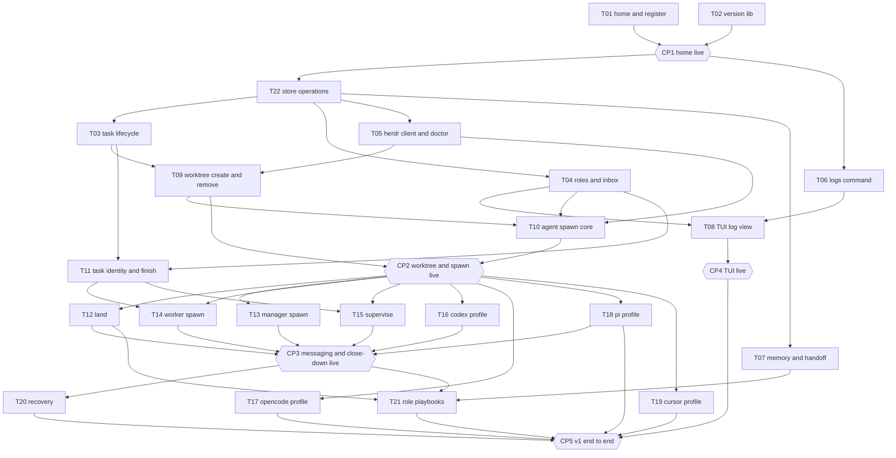

# Tracker

This file is the live record of the hive v1 plan. [tasks/README.md](tasks/README.md)
gives the brief format. [evidence/README.md](evidence/README.md) gives the
evidence format. [03-architecture.md](03-architecture.md) gives the design that
the tasks build. Only the merger edits this file, on `dev`.

## Status values

| Status | Meaning |
| --- | --- |
| blocked | A prerequisite is not landed, or a checkpoint before the task is open. |
| ready | Each prerequisite has the status landed, and each checkpoint before the task passed. A worker can start. |
| in progress | A worker has the task in a worktree. |
| evidence | Each `V<n>.md` exists on the task branch. The verifier can start. |
| verified | `VERIFIED.md` records a pass for each item. The merger can land the task. |
| landed | The task branch is in `dev`. The worktree is gone. |
| skipped | The user skipped the task. The row gives the reason. |

A checkpoint has the status open, passed, or changes requested.

## Waves

| Wave | Tasks | Starts after |
| --- | --- | --- |
| 1 | T01, T02 | The commit of the plan to `dev` |
| 2 | T22, T03, T04, T05, T06, T07 | CP1 and the installed spec |
| 3 | T08, T09, T10, T11 | The prerequisites of each task |
| 4 | T12, T13, T14, T15, T16, T17, T18, T19 | CP2 |
| 5 | T20, T21 | CP3 |

## Graph

A box is a task. A hexagon is a checkpoint. An arrow means "must land, or
pass, before". The graph shows each edge through the nearest checkpoint. The
header of a brief also lists each task that the brief builds on directly.



## Progress

| Task | Title | Wave | Tier | Depends on | Status | Verified by | Landed |
| --- | --- | --- | --- | --- | --- | --- | --- |
| [T01](tasks/T01-home-and-register.md) | home and register | 1 | strong | none | landed | openai-codex/gpt-6.1-sol | 2026-10-18 |
| [T02](tasks/T02-version-lib.md) | version lib | 1 | small | none | landed | opencode-go/deepseek-v4.1-flash | 2026-10-17 |
| [T22](tasks/T22-store-operations.md) | store operations | 2 | strong | T01, CP1 | landed | openai-codex/gpt-6.1-sol | 2026-10-18 |
| [T03](tasks/T03-task-lifecycle.md) | task lifecycle | 2 | decent | T01, T22, CP1 | landed | openai-codex/gpt-6.1-sol | 2026-10-18 |
| [T04](tasks/T04-roles-and-inbox.md) | roles and inbox | 2 | decent | T01, T22, CP1 | landed | openai-codex/gpt-6.1-sol | 2026-10-18 |
| [T05](tasks/T05-herdr-client-and-doctor.md) | herdr client and doctor | 2 | strong | T01, T22, CP1 | landed | openai-codex/gpt-6.1-sol | 2026-10-18 |
| [T06](tasks/T06-logs-command.md) | logs command | 2 | decent | T01, CP1 | landed | openai-codex/gpt-6.1-sol | 2026-10-18 |
| [T07](tasks/T07-memory-and-handoff.md) | memory and handoff | 2 | small | T01, T22, CP1 | landed | openai-codex/gpt-6.1-sol | 2026-10-18 |
| [T08](tasks/T08-tui-log-view.md) | TUI log view | 3 | decent | T04, T06 | in progress | | |
| [T09](tasks/T09-worktree-create-and-remove.md) | worktree create and remove | 3 | decent | T03, T05 | evidence | | |
| [T10](tasks/T10-agent-spawn-core.md) | agent spawn core | 3 | strong | T04, T05, T09 | blocked | | |
| [T11](tasks/T11-task-identity-and-finish.md) | task identity and finish | 3 | small | T03, T04 | landed | openai-codex/gpt-6.1-sol | 2026-10-18 |
| [T12](tasks/T12-land.md) | land | 4 | decent | T03, T09, CP2 | blocked | | |
| [T13](tasks/T13-manager-spawn.md) | manager spawn | 4 | decent | T10, CP2 | blocked | | |
| [T14](tasks/T14-worker-spawn.md) | worker spawn | 4 | decent | T09, T10, T11, CP2 | blocked | | |
| [T15](tasks/T15-supervise.md) | supervise | 4 | strong | T04, T10, T11, CP2 | blocked | | |
| [T16](tasks/T16-codex-profile.md) | codex profile | 4 | small | T10, CP2 | blocked | | |
| [T17](tasks/T17-opencode-profile.md) | opencode profile | 4 | small | T10, CP2 | blocked | | |
| [T18](tasks/T18-pi-profile.md) | pi profile | 4 | small | T10, CP2 | blocked | | |
| [T19](tasks/T19-cursor-profile.md) | cursor profile | 4 | small | T10, CP2 | blocked | | |
| [T20](tasks/T20-recovery.md) | recovery | 5 | small | T13, T15, CP3 | blocked | | |
| [T21](tasks/T21-role-playbooks.md) | role playbooks | 5 | strong | T07, T12, T13, T14, T15, CP3 | blocked | | |

| Checkpoint | After | Blocks | Status | Date | Verdict by |
| --- | --- | --- | --- | --- | --- |
| CP1 home live | T01, T02 | wave 2 | passed | 2026-10-18 | runner `cp1-run-01.md`. Independent `pi/openai-codex/gpt-6.1-sol:high` `cp1-verify-01.md` |
| CP2 worktree and spawn live | T09, T10 | wave 4 | open | | |
| CP3 messaging and close-down live | T12, T13, T14, T15, T16, T18 | wave 5 | open | | |
| CP4 TUI live | T08 | CP5 | open | | |
| CP5 v1 end to end | T17, T18, T19 landed or skipped, T20, T21, CP4 | the end of v1 | open | | |

## Tiers

| Tier | Use | Bootstrap choice |
| --- | --- | --- |
| strong | Core design, concurrency, the herdr client, the supervisor, the playbooks | pi with `openai-codex/gpt-6-luna` at the thinking level `xhigh` |
| decent | Ordinary command and library work | pi with `openai-codex/gpt-6-luna` at the thinking level `xhigh` |
| small | A move, a profile, a small command | pi with `openai-codex/gpt-6-luna` at the thinking level `xhigh` |
| verifier | Each task | Claude Code with `claude-opus-5-5` for a strong or decent task. pi with `opencode-go/deepseek-v4.1-flash` for a small task. The verifier and the worker are from different model families. |

The dated wave 2 route clarification under Checkpoints replaces this bootstrap
choice for wave 2. It does not change the tier of a task.

## Checkpoints

The user runs each script from the root of the home, on `dev`, after the
merges that the checkpoint names. Each script builds the binary first. A line
of the form `NAME=<...>` means: copy the value from the output of the command
before it. The user then writes the critique into the field. A critique that
changes the design goes into the design file first, then into the briefs that
it affects, with the date. The checkpoint then passes.

The dated clarification below changes these steps.

### Dated procedure clarification: autonomous completion

2026-10-18. The user gave this instruction:

```text
I go to sleep, forget the user presentation demo gates, just complete all of the tasks okay?
```

This clarification changes the checkpoint procedure:

- Routine progress goes in this tracker and in `handoff.md`. Do not wait for a user verdict.
- An automated independent check replaces the user presentation approval for each checkpoint.
- Keep each checkpoint script and each acceptance criterion.
- A checkpoint passes only after its automated independent check passes. Until then, it stays open, and its blocked tasks stay blocked.

### Dated procedure clarification: wave 2 install and routes

2026-10-18. This clarification records the current wave 2 state and routes.

- The corrected spec install precedes code dispatch. The install is one commit on `dev` and follows the corrected plan below `.hive/tmp/coordinator/plans/remaining-v1-r2/`.
- CP1 passed on 2026-10-18. The runner report is `.hive/tmp/coordinator/reports/cp1-run-01.md`. The independent verdict is `.hive/tmp/coordinator/reports/cp1-verify-01.md` from `pi/openai-codex/gpt-6.1-sol:high`. Do not rerun CP1.
- T22 and T06 are ready. T03, T04, T05, and T07 stay blocked on T22.
- Each implementation uses `pi opencode-go/deepseek-v4-flash`. Each independent verifier and each independent spec check uses `pi openai-codex/gpt-6.1-sol:high`. This route replaces the bootstrap choice for wave 2.
- Do not reuse an agent for a later pass. Start at most three external agents beside the coordinator.
- A fresh independent agent checks each concrete implementation brief and each concrete verifier brief before dispatch. The check reports `pass` or `fail` with item IDs. It is not an approval.
- A task worktree branches from a `dev` commit that contains the installed spec and each landed prerequisite. Require the CP1 PASS report separately.
- A pending independent check of the installed spec is not an approval. Do not dispatch code until that check passes.

### Dated correction and preflight gate: wave 2 text correction 02

2026-10-18. This clarification records the correction after the installed-spec
verification `wave2-spec-verify-02.md` returned FAIL on R01 through R08.

- The correction pass is `wave2-spec-fix-prep-02.md`. Its corrected drafts are below `.hive/tmp/coordinator/plans/remaining-v1-r3/`.
- T22 and T06 move from `ready` to `in progress` for preparation only. A worktree exists for each. No implementation started. T03, T04, T05, and T07 stay blocked.
- The approved design is separate from code dispatch. `implementation_allowed` stays false until the installed task and the concrete brief of a task pass their own independent preflight. `implementation_started` stays false.
- A task starts only after its own installed task file and its own concrete implementation brief pass an independent review. Unrelated blocked tasks stay blocked. T22 and T06 are the only tasks in preparation now.
- The route is `pi opencode-go/deepseek-v4-flash:medium` for implementation and `pi openai-codex/gpt-6.1-sol:high` for verification.
- A fresh independent preflight checks the corrected result before any source agent starts. No manual user approval wait applies.
- The `ready` status in the install clarification above is historical. This dated section replaces it.

### Dated progress receipt: wave 2 source implementation and T02 audit

2026-10-18. This section records progress. It changes no task status and no
dependency.

- `wave2-dispatch-preflight-03.md` reports PASS at `840255d3`. The pass covers
the corrected installed text, the current records, the T22 brief, the T06 brief,
and the six verifier templates. It permits only the two checked implementation
payloads. It does not verify code and does not unblock T03, T04, T05, or T07.
- The preflight keeps one planner-only R04 defect open in
`E-spec-edit-checklist.md`. Do not reuse that checklist instruction. The defect
does not block the T22 or T06 dispatch.
- T22 runs in `wA4:p1` as `hive-t22-impl-01` with `pi
opencode-go/deepseek-v4-flash:medium`. The workspace is `wA4`. The terminal is
`term_65e161d77e9db10`. The observed branch tip is `d9b644f7`. The worker report
marker is present. The code is not verified and not landed.
- T06 runs in `wA5:p1` as `hive-t06-impl-01` with the same route. The workspace
is `wA5`. The terminal is `term_65e161da1896e11`. The observed branch tip is
`1c556c33`. The worker report marker is present. The code is not verified and
not landed.
- Each pane reports the agent `pi` with the status `done`. This observation is
not evidence of code success. Test, evidence, and verification status stay pending.
- T03, T04, T05, and T07 remain `blocked` on T22.
- `t02-sol-audit-01.md` reports V1, V2, and V3 PASS at `840255d3` with `pi
openai-codex/gpt-6.1-sol:high`. The audit adds evidence to the T02 record. It
does not replace the original verdict. The T02 row keeps its landing date
`2026-10-17` and its original verifier `opencode-go/deepseek-v4.1-flash`.

### Dated clarification: later-wave contracts and routes 03

2026-10-18. This clarification records the later-wave contracts. It changes no
Go source.

- T10 owns `internal/lib/process/`. T15 imports it.
- T11 checks the caller identity, the role, the task, the project, the claim
  key, the holder record key, and the generation under one held handle.
- T13 keeps the workspace metadata when the recorded root is missing or moved.
- T14 uses the current pane ID and the real Git branch.
- T09 lands before T10. T09 corrects `WorkspaceInfo.Worktree` and adds the typed `WorkspaceWorktreeInfo`. T10 reads the optional session fields of `AgentInfo` and `PaneInfo`.
- The limit of three external agents beside the coordinator includes each native model child that a live check starts. A native-live owner reserves its child slots before the run. Do not start an extra agent beyond three. This rule adds no slot infrastructure and changes no task dependency.
- T20 compares `process_pid` and `process_start` when the record holds them.
- T12 and T18 run after CP2 and before CP3. CP3 adds the fixture task, the
  fixture land, and the clean merged removal.
- CP3 to CP5 use the corrected evidence rules.
- Implementation and source verification for all waves use external Pi.
  Implementation requests `pi opencode-go/deepseek-v4-flash:medium`. Source
  verification uses `pi openai-codex/gpt-6.1-sol:high`.
- A native non-Pi harness smoke tests product interoperability only. It
  discovers the exact installed models first. It never implements or verifies
  Hive source.
- Only T19 retains the authorized quota skip.
- Pi 0.87.1 maps native DeepSeek `:medium` to null. Supported-level clamping
  selects the effective `high`. Record the requested `:medium` and the effective
  `high` separately. Keep the requested argument. This is native normalization
  of the same provider and model. Do not change a global catalog or config.
  PiSol `:high` stays effective `high`. A wrong or absent actual model blocks.
- CP2 to CP5 stay open. No user presentation approval applies.
- CP5 uses the real registered Hive home, project, and `dev`. It creates no
  replacement fixture. The artifact is `reference/dogfood/cp5.md`. The tracked
  evidence is `spec/hive-v1/evidence/CP5-<pass>/VERIFIED.md`. Root `VERIFIED.md`
  is also permitted by `!*.md`. Do not change the allowlist and do not force an
  add.
- Capture local `main`, `origin/main`, and the direct remote `main` separately
  before and after CP5. Compare each value with its own prior value. The current
  local `main` is `3692162633f896b8fee6197469adba91f666a00c`. `origin/main` and
  the direct remote `main` are `928cfa95e0906315fcb4a65a5cdbdef1470a0503`. They
  differ. Never move a `main` reference to make them equal.
- Bootstrap clause removal needs actual manager-first-worker evidence. Do not
  remove the clause in this docs pass.

### Dated evidence receipt: wave 2 T22 and T06

2026-10-18. This section records the worker evidence for T22 and T06. It
changes only the status of these tasks.

- T22 moves from `in progress` to `evidence`. Branch `task/T22-store-operations`
starts at base `840255d3` and ends at `d9b644f7`. Worktree
`projects/hive/worktrees/T22-store-operations` stays. Pane `wA4:p1` uses terminal
`term_65e161d77e9db10` and route `pi opencode-go/deepseek-v4-flash:medium`.
- T06 moves from `in progress` to `evidence`. Branch `task/T06-logs-command`
starts at base `840255d3` and ends at `1c556c33`. Worktree
`projects/hive/worktrees/T06-logs-command` stays. Pane `wA5:p1` uses terminal
`term_65e161da1896e11` and the same route.
- Evidence `V1` to `V5` exists on the T22 branch. Evidence `V1` to `V4` exists
on the T06 branch. Each file has a commit. No `VERIFIED.md` exists for either
task.
- The coordinator archived the worker reports. T22 archive SHA256
`0d97e7cc418ad7e7706105712824383bb16df02f78ad98e7c1572527422fafcc`. T06 archive
SHA256 `c162692fb75b351e577328942aafc610e06dce9593d5c82a18e3b02af3de35ec`. Each
archive equals its source.
- The state receipt is `.hive/tmp/coordinator/state/wave2-evidence-01.json`.
Independent verification stays pending for both tasks.
- T22 and T06 code is not verified and not landed. T03, T04, T05, and T07 stay
`blocked` on T22. No other status, dependency, or model route changes.

### Dated repair receipt: wave 2 T22 and T06

2026-10-18. This section records the independent verification results. It
changes only the status of these tasks and adds one home check.

- T22 moves from `evidence` to `in progress` for repair. The verifier pass
`t22-verify-01.md` returned FAIL at verification commit `3c14453c`. The checked
worker commit is `d9b644f7`. The path check `t22-path-verify-01.md` returned
FAIL on the same worker commit.
- T22 F1: temporary-name filtering hides directories and links (AC2, AC3). The
walk skips a directory named `.probe.tmp-123`. It also skips a linked collection
in silence.
- T22 F2: the fixed-size tests use the implementation constant. A 2 MiB mutation
keeps the V2 suite green. `generic_test.go:188` to `207` gives the reason.
- T22 path F01: a static `.hive` ancestor link escapes containment. `store.Open`
creates an external state root through the link.
- T22 path F02: `store.Open` accepts a static linked state root. Later operations
reject the same root.
- T06 moves from `evidence` to `in progress` for repair. The verifier pass
`t06-verify-01.md` returned FAIL at verification commit `c9016cf0`. The checked
worker commit is `1c556c33`.
- T06 F1: the line-cap tests use the implementation constant `maxLineBytes`.
- T06 F2: follow does not apply the cutoff to new events.
- T06 F3: follow diagnostics use a relative line number.
- T06 F4: a component newline splits one text event into two physical lines.
- T06 F5: JSON read errors print an envelope on stdout. The brief requires one
plain diagnostic on stderr.
- The coordinator copied the exact tracked `VERIFIED.md` from each worktree. T22
archive `.hive/tmp/coordinator/reports/t22-verify-01-archive.md` has 25467 bytes
and SHA256 `7c2d54f583a17c013ce09409786a0269bd0238d3d4e3b4b7cad3a2749325a464`.
T06 archive `.hive/tmp/coordinator/reports/t06-verify-01-archive.md` has 75031
bytes and SHA256
`ca9a28c9ef062589a2e2160f53cf264095e336adb90b6bf28285b41337cb42b5`. Each archive
equals its source.
- Repair agents `hive-t22-fix-01` and `hive-t06-fix-01` run with `pi
opencode-go/deepseek-v4-flash:medium`. Both panes reported the status `working`
at 2026-10-18 01:30 EDT. Repair commits `d8155e5c` and `dc7964cb` exist at
01:32 EDT. No repair report or repair verification exists.
- A bounded static-link check finds a home gap before logger start. With `H/.hive`
as a link to an external directory that holds a regular `README.md`, `hive
--home H project list` exits 0. That command writes `logs/2026-10-18.jsonl` and
`state/` below the external directory. `home.Resolve` accepts the link because
`os.Lstat` follows the `.hive` parent. `cmd/common` then calls `log.Open`, and
the store opens the same way. Both call `os.MkdirAll` below `.hive` with no type
check.
- Recommendation: T01 owns a static `.hive` type check in `home.Resolve` and the
logger start path. T22 keeps its store root check.
- T22 and T06 code is not verified and not landed. T03, T04, T05, and T07 stay
`blocked` on T22. No other status, dependency, or model route changes.

### Dated verification receipt: wave 2 T22 and T06

2026-10-18. This section records the independent verification of T22 and T06. It
changes only the status of these tasks.

- T22 moves from `in progress` to `verified`. Branch `task/T22-store-operations`
has base `840255d3`. The tested worker commit is `a3fea5a4`. The verification
commit is `0217df27`. Its parent is `a3fea5a4`. Its only change is
`spec/hive-v1/evidence/T22-store-operations/VERIFIED.md`.
- T06 moves from `in progress` to `verified`. Branch `task/T06-logs-command` has
base `840255d3`. The tested worker commit is `ce9b992b`. The verification
commit is `b8006a86`. Its parent is `ce9b992b`. Its only change is
`spec/hive-v1/evidence/T06-logs-command/VERIFIED.md`.
- Each verifier ran `pi openai-codex/gpt-6.1-sol:high`. These are the actual
provider, model, and level from the `PI_*` values. The route matches the dated
wave 2 route.
- The T22 report is `.hive/tmp/coordinator/reports/t22-verify-02.md`. Its last
line is `END VERIFIER T22-store-operations t22-verify-02`. V1 to V5 are PASS.
- The T06 report is `.hive/tmp/coordinator/reports/t06-verify-02.md`. Its last
line is `END VERIFIER T06-logs-command t06-verify-02`. V1 to V4 are PASS.
- Each `VERIFIED.md` keeps its earlier FAIL sections as history. The latest
dated section in each file is PASS.
- Both remote task branches equal their local verification commits. Both task
worktrees are clean.
- The coordinator copied the worker fix reports to
`.hive/tmp/coordinator/reports/t22-fix-01-archive.md` and
`.hive/tmp/coordinator/reports/t06-fix-01-archive.md`. Each copy equals its
source.
- T22 and T06 stay `verified` and not landed. T03, T04, T05, and T07 stay
`blocked` on T22. No other status, dependency, or model route changes.

### Dated landing receipt: wave 2 T22 and T06

2026-10-18. This section records the landing of T22 and T06 on `dev`. It changes
only the status of these tasks.

- The merger landed `task/T22-store-operations` first at verification commit
`0217df27`. The merge commit is `0d0c9d4e`. The subject is `merge(T22): land
store operations`.
- The merger landed `task/T06-logs-command` second at verification commit
`b8006a86`. The merge commit is `84da9819`. The subject is `merge(T06): land
logs command`.
- Both merges used `--no-ff`. Neither merge had a conflict.
- The combined root passes the gate. `gofmt -l` prints nothing. `go vet ./...`
exits 0. `golangci-lint run --allow-serial-runners ./...` reports `0 issues.`
`go test -race -count=1 ./...` passes each package.
- Each task-owned source path and evidence path in `dev` equals its verification
tip. The shared `cmd/root.go` has only the T06 import line and the T06
registration line.
- The push reached `origin/dev` at `84da9819` without force.
- The coordinator archived the full T22 worktree at
`.hive/tmp/coordinator/archives/T22-0217df27/`. It archived the full T06 worktree
at `.hive/tmp/coordinator/archives/T06-b8006a86/`. Each archive excludes the
`.git` pointer file. Each archive manifest equals the original manifest.
- `herdr worktree remove --workspace wA4` removed workspace `wA4`, pane
`wA4:p1`, terminal `term_65e161d77e9db10`, and the T22 worktree.
`herdr worktree remove --workspace wA5` removed workspace `wA5`, pane `wA5:p1`,
terminal `term_65e161da1896e11`, and the T06 worktree. Neither command used
force.
- Both branches `task/T22-store-operations` and `task/T06-logs-command` stay at
their verification commits, local and remote.
- The hive workspace `w9X` and the T01 follow-up workspace `wA6` stay.
- The T22 and T06 rows show `landed` with verifier `openai-codex/gpt-6.1-sol`
and date `2026-10-18`.
- T03, T04, T05, and T07 move from `blocked` to `ready`. Each prerequisite is
landed and CP1 passed.
- T08 stays `blocked` on T04.
- No other status, dependency, or model route changes.

### Dated dispatch receipt: wave 2 next track

2026-10-18. This section records the dispatch of T03 and T04. It records the
preparation of T05 and T07. It corrects three old record items. It changes only
the T03, T04, and T05 status. It accepts no task source.

- The independent root code integration check passes at `af3e5f69`.
  `.hive/tmp/coordinator/reports/t01-home-and-wave2-verify-01.md` gives PASS in
  its `B integration` section and ends with `END T01 HOME AND WAVE2 VERIFY 01`.
  That pass covers the root integration. It is not a source acceptance.
- `.hive/tmp/coordinator/reports/wave2-next-preflight-01.md` gives one contract
  PASS for each of the four payloads `t03-impl-01`, `t04-impl-01`,
  `t05-impl-01`, and `t07-impl-01`. Its last line is
  `END WAVE2 NEXT PREFLIGHT 01`. A contract PASS checks a brief only. Do not read
  it as a source PASS.
- The coordinator saved the four checked payloads below
  `.hive/tmp/coordinator/briefs/` with exact bytes:
  - `t03-impl-01.md` has 12242 bytes and SHA256
    `b83c479d47556c4029dfd4d7f707925979f9e054b4a0d8607ec43fd39d5d5737`.
  - `t04-impl-01.md` has 17247 bytes and SHA256
    `e6d6d2fddb5b4511573fc2d112ef3d1877b44391372972f24abf126dc5b6957e`.
  - `t05-impl-01.md` has 12053 bytes and SHA256
    `4c2d1d383e72057e0b05a5a0f5a7034b86a97fc8ebd93fb2626f4bd2495489f4`.
  - `t07-impl-01.md` has 13409 bytes and SHA256
    `67e71c864906827a96a348f69aec3ba6fb6b7146faf83c5a358ce59394e2741c`.
- T03 moves from `ready` to `in progress`. Branch `task/T03-task-lifecycle` and
  worktree `projects/hive/worktrees/T03-task-lifecycle` have base `84da9819`.
  Agent `hive-t03-impl-01` runs with the route
  `pi opencode-go/deepseek-v4-flash:medium` in workspace `wA7`, pane `wA7:p1`.
- T04 moves from `ready` to `in progress`. Branch `task/T04-roles-and-inbox` and
  worktree `projects/hive/worktrees/T04-roles-and-inbox` have base `84da9819`.
  Agent `hive-t04-impl-01` runs with the same route in workspace `wA8`, pane
  `wA8:p1`.
- T05 moves from `ready` to `in progress` for preparation only. Branch
  `task/T05-herdr-client-and-doctor` and worktree
  `projects/hive/worktrees/T05-herdr-client-and-doctor` have base `84da9819`.
  Workspace `wA9` and pane `wA9:p1` exist. No agent runs in that pane.
  `implementation_allowed` is true. `implementation_started` is false. Agent
  `hive-t05-impl-01` is pending.
- T07 stays `ready`. Branch `task/T07-memory-and-handoff` and worktree
  `projects/hive/worktrees/T07-memory-and-handoff` have base `84da9819`.
  Workspace `wAA` and pane `wAA:p1` exist. No agent runs in that pane. The
  coordinator prepares the task and queues it. The task does not run.
- Each implementation route is `pi opencode-go/deepseek-v4-flash:medium`. The
  observed thinking level is `high`. The brief names `medium`. The two values
  agree with the dated wave 2 route. Each future verifier uses a fresh
  `pi openai-codex/gpt-6.1-sol:high` agent.
- `herdr agent list` reports the status `working` for `hive-t03-impl-01` and
  `hive-t04-impl-01`. This observation is not evidence of source success. Test,
  evidence, and verification status stay pending.

### Dated correction receipt: wave 2 records R01, R02, and B01

2026-10-18. This section corrects three record items. It keeps each original
report. It changes no task status and no dependency.

- R01: `wave2-repair-prep-01.md` and its state record said that the final 12580
  bytes differ from the historical section. The two selections are equal. The
  final 12580 bytes equal the bytes after the historical marker. Each selection
  has SHA256
  `0c0d843ff49e0e6d8efc60425630ea2183b1f9c0ca5aecb8d53a29c035a1bd69`. The
  historical text did not change.
- R02: the absent saved brief did not prove that no check ran. The coordinator
  records a fresh no-tools `pi openai-codex/gpt-6.1-sol:high` check before the
  past dispatch. Its results were T22 PASS, T06 PASS, and ROOT PASS. No
  independent inspection of that in-memory check occurred. The field
  `checked_repair_brief_found: false` stays as a dated file-discovery snapshot.
- The four new saved briefs above are current evidence. They do not change the
  old transcript.
- B01: `wave2-land-01.md:20` and its state record gave remote `main` as local
  `main`. The actual local `main` is
  `3692162633f896b8fee6197469adba91f666a00c`. `origin/main` and the direct
  remote `main` are `928cfa95e0906315fcb4a65a5cdbdef1470a0503`. Each value
  stayed unchanged. The local `main` reflog shows its last change on
  2026-08-20. Do not move a `main` reference to make an old record true.
- The combined records verdict stays FAIL on B01. The code integration verdict
  is PASS. Keep the two verdicts separate.

### Dated evidence receipt: wave 2 boundary spec

2026-10-18. This section records the wave 2 source reports, two necessary
contract corrections, and the T22 write-cap fix. It changes only the T22,
T03, T04, T05, and T07 status.

- T03 source work is complete at
`638c40e339abb329912d7c09b06d609ddc1c69b3` on `task/T03-task-lifecycle`. The
local and remote branch agree. The report archive is
`.hive/tmp/coordinator/reports/t03-impl-01-archive.md`, 8143 bytes, SHA256
`be567dc7afd8be4cc34a601a6a7fbde01dea1d9baf3c17260ca603f49c828cac`. It ends
with `END WORKER T03-task-lifecycle t03-impl-01`. `V1.md` to `V4.md` exist on
the branch. T03 moves from `in progress` to `evidence`.
- T04 source work is complete at
`7a6250f3f20d2a4fb497c9aa4540628651cb79ae` on `task/T04-roles-and-inbox`. The
local and remote branch agree. The report archive is
`.hive/tmp/coordinator/reports/t04-impl-01-archive.md`, 7428 bytes, SHA256
`0767d618e1b33b3c399662b72f8ae6ca69c2c12751a8dd0466638feffec73784`. It ends
with `END WORKER T04-roles-and-inbox t04-impl-01`. `V1.md` to `V4.md` exist on
the branch. T04 moves from `in progress` to `evidence`.
- T05 source work is complete at
`30bd4fc4a5a504ca5ea1a79dc2023202c117ef7e` on
`task/T05-herdr-client-and-doctor`. The local and remote branch agree. The report
archive is `.hive/tmp/coordinator/reports/t05-impl-01-archive.md`, 9073 bytes,
SHA256 `585bd0129b91a8e375920a90fe3f8e04c34f9919892cc45419adeed8a47d6c35`. It
ends with `END WORKER T05-herdr-client-and-doctor t05-impl-01`. `V1.md` to
`V6.md` exist on the branch. T05 moves from `in progress` to `evidence`.
- Each source worker finished and stopped. No independent source review ran for
T03, T04, or T05. Branch evidence is not a source acceptance.
- T03 found a store gap. `Create` and `Verify` returned `ok` for two 2 MiB
fields. The records were 2097510 and 2097511 bytes. `Show` and `List` then
failed with `record too large`. This is a successful-write and read-limit
inconsistency. It does not ask for a title limit. A Linux argument limit of
131072 bytes does not bound the entire encoded record. Multiple escaped fields
can go above 1 MiB.
- Necessary correction D1: a task record has an optional `cancel_reason` string
with `omitempty`. The `cancel --reason` value goes there. An absent or empty
reason omits the field. The field does not replace `verification`. No other
schema change occurs. The source chose this field before this text. This is not
source acceptance.
- Necessary correction D2: `writeRecordFile` rejects an encoded record above
1048576 bytes before `atomicWrite` creates or replaces a record. The error is
`record too large: <path>`, as the reader gives. An encoded record of exactly
1048576 bytes, with the final newline, is valid. A rejected write keeps the old
bytes and makes no new record. The legacy, generic, and locked write and update
paths use the check. The store adds no title limit, no journal, no rollback, no
public API, and no dependency. A multi-write caller reports its earlier effects.
The reader and lock contracts do not change.
- T22 moves from `landed` to `in progress` for this fix. The fix branch is
`task/T22-write-cap`. The fix worktree is
`projects/hive/worktrees/T22-write-cap`. It starts from the installed-doc commit
of this pass. The old values stay: status `landed`, verifier
`openai-codex/gpt-6.1-sol`, date `2026-10-18`, merge `0d0c9d4e`, first
verification `0217df27`, branch `task/T22-store-operations`, and archive
`.hive/tmp/coordinator/archives/T22-0217df27/`. The first landing receipt and
its attribution stay.
- T07 moves from `ready` to `blocked` while T22 is in progress. T03, T04, and T05
cannot land until the T22 store follow-up passes. Their own work is complete.
- D4 correction: the earlier R02 receipt gave the no-tools model argument as
`pi openai-codex/gpt-6.1-sol:high`. The coordinator requested
`pi openai-codex/gpt-6.1-sol:medium` in session 62283. That check gave T22 PASS,
T06 PASS, and ROOT PASS. The runtime thinking level was not captured
independently in that no-tools pass. The original report
`wave2-next-track-01.md` keeps its bytes. Future source verifiers still use
`:high`.
- B01 correction: the local `main` and the remote `main` stay different values.
The local `main` is `3692162633f896b8fee6197469adba91f666a00c`. `origin/main`
and the remote `main` are `928cfa95e0906315fcb4a65a5cdbdef1470a0503`. The B01
independent check is still pending. Do not claim equal references.
- This section removes no earlier source or checkpoint PASS. No other
prerequisite changes. T08 stays `blocked` on T04.

### Dated landing receipt: cap and home follow-ups

2026-10-18. This section records the cap and home landings, the status
changes, and the T22 punctuation deviation. It accepts only the verified
changes.

- The cap branch `task/T22-write-cap` has worker tip `a05e617e` and verified
tip `30ef7e2d`. The independent report `t22-write-cap-verify-01.md` gives V1 to
V5 PASS and shared G1 CLOSED. Its last line is `END T22 WRITE CAP VERIFY 01.`
That final period differs from the planned marker without a period. The report
stays unchanged. The period is a record deviation only.
- The merger landed `task/T22-write-cap` into `dev` at verified tip `30ef7e2d`.
The merge commit is `d6f28d83`. The subject is `merge(T22): land the store write
cap`. The first parent is `7ae3fb8a`. The second parent is `30ef7e2d`.
- The home branch `task/T01-static-home` has source `72c7ac48` and verified tip
`938d8737`. The independent report `t01-home-and-wave2-verify-01.md` gives A
SOURCE PASS. The tip adds only `STATIC-HOME-VERIFIED.md` after the tested worker
`e4cc4a81`.
- The merger landed `task/T01-static-home` into `dev` at verified tip
`938d8737`. The merge commit is `a8d6547c`. The subject is `merge(T01): land the
static home follow-up`. The first parent is `d6f28d83`. The second parent is
`938d8737`.
- The combined gate passes at `a8d6547c`. `gofmt -l` prints nothing. `go vet
./...` exits 0. `golangci-lint run ./...` reports `0 issues.` `go test -race
-count=1 ./...` passes each package.
- Each cap source and evidence path in `dev` equals its `30ef7e2d` object. Each
home path in `dev` equals its `938d8737` object. Only the verified task diff
enters each merge.
- T22 returns to `landed`. The verifier is `openai-codex/gpt-6.1-sol` and the
date is `2026-10-18`. The earlier landing receipt, merge `0d0c9d4e`, first
verification `0217df27`, branch `task/T22-store-operations`, and archive
`.hive/tmp/coordinator/archives/T22-0217df27/` stay.
- The T01 row keeps `landed`, verifier `openai-codex/gpt-6.1-sol`, and date
`2026-10-18`. The accepted follow-up landing is the `a8d6547c` merge. The T01
and T02 historical attribution does not change.
- T03 moves from `evidence` to `in progress` to prepare a fix. The
independent `t03-verify-01.md` returned FAIL on T03 F1 to F4. The source is not
verified.
- T04 moves from `evidence` to `in progress` to prepare a fix. The
independent `t04-verify-01.md` and `t04-inbox-verify-01.md` returned FAIL. The
source is not verified. The historical reports stay.
- T07 moves from `blocked` to `ready`. T22 has the status landed and CP1 passed.
- T05 stays `evidence`. Its primary review returned FAIL at `b361a0c8`. A
separate secondary review continues. No combined source verdict changes its
status.
- No other task status, checkpoint, dependency, or model route changes. CP2
through CP5 stay open.

### Dated source receipt: wave 2 fix and T22 walk follow-up

2026-10-18. This section records the current source state. It accepts no
unverified source.

- T03 stays `in progress`. The prior `t03-verify-01.md` review returned FAIL on
  F1 to F4. Dispatch `hive-t03-impl-01` continues the fix on branch
  `task/T03-task-lifecycle` at `ba91e8a7` in its isolated worktree. A fresh
  independent source verdict is pending.
- T04 stays `in progress`. The prior `t04-verify-01.md` and
  `t04-inbox-verify-01.md` reviews returned FAIL. Dispatch `hive-t04-impl-01`
  continues the fix on branch `task/T04-roles-and-inbox` at `34ae0363` in its
  isolated worktree. A fresh independent source verdict is pending.
- T05 stays `in progress` in this record. The primary review returned FAIL at
  `b361a0c8`. Dispatch `hive-t05-impl-01` continues the fix on branch
  `task/T05-herdr-client-and-doctor` at `fb19808b` in its isolated worktree. The
  combined verdict is pending.
- T07 stays `ready`. No agent runs in its prepared worktree. A fresh brief
  check is still needed before dispatch.
- The new independent integration verification is pending. Do not claim it
  passed. The cap and home landings at `d6f28d83` and `a8d6547c` stay.
- T22 stays `landed` for the store operations and write-cap work. S05-D01 is a
  separate open follow-up. `WalkRecords` ignores a FIFO or socket at a non-json
  collection path and reports `ok state store: 0 records`. The earlier landing
  history stays. Do not claim this defect closed.
- The T22 walk follow-up worktree `projects/hive/worktrees/T22-walk-types` is
  prepared at `c6a4d91d`. Workspace `wAC`, pane `wAC:p1`, and terminal
  `term_65e182272b92818` exist. No source agent started there. The preparation
  is not a dispatch and not a source acceptance.
- The historical R01, R02, and B01 corrections stay as the independent
  `t03-verify-01.md` and `spec-verdict.json` record them. Do not redo them.

### Dated landing and fix receipt: lifecycle, store, and later contracts

2026-10-18. This section records the current task, source, and contract state.
It accepts no unverified source and passes no checkpoint.

- T03 is `landed`. The verified tip is `e467682e`. The merge is `47da8abb`. The
  source equality check and the full uncached gate pass. The worktree archive is
  `.hive/tmp/coordinator/archives/T03-e467682e/`. The no-force removal reply
  names the T03 path and workspace `wA7`. The branch stays.
- T22 remains `landed`. The walk follow-up merge is `16bbd00f` for tip
  `ccfe0020`. The T22 candidate closes S05-D01. The combined store comes from
  the T22 candidate. The worktree archive is
  `.hive/tmp/coordinator/archives/T22-ccfe0020/`. The no-force removal reply
  names the T22 path and workspace `wAC`. The branch stays.
- The docs correction is `a01167c`. It fixes C01 to C07 and the R01 receipt.
  The independent installed-text recheck is pending.
- The recipe and type-scope correction is the docs commit of pass
  `later-text-fix-02`. It fixes C04, C06, and C07. It adds the T09 and T10 type
  scopes. The independent installed-text recheck is pending.
- T04 is `in progress`. Fix pass `t04-fix-02` has verdict `64fdb038`. Four
  IDs stay open: P-F02, P-F06, I-F03, and I-F04. No source acceptance.
- T05 is `in progress`. Prerequisite sync `5a7e1264` merges `47da8abb` into
  `task/T05-herdr-client-and-doctor`. The old FAIL verdict stays. The sync gate
  passes. Independent source verification is pending.
- T07 is `in progress`. Agent `t07-impl-01` runs in `wAA`. Do not touch its
  worktree, branch, or report.
- CP2 to CP5 stay open. This receipt claims no future source or checkpoint
  pass.

### Dated landing receipt: roles and inbox

2026-10-18. This section records the T04 landing. It accepts no T05 or T07
source and passes no checkpoint.

- T04 is `landed`. The verified tip is `4ef23d20`. The verdict report is
  `t04-verify-03.md`, with `END VERIFIER T04-roles-and-inbox t04-verify-03`
  and PASS for V1 to V4. The tested worker is `c33f5896`.
- The merge is `19e41ee6` with subject `merge(T04): land roles and inbox`.
  Its parents are `21ea1e65` and `4ef23d20`. The branch is
  `task/T04-roles-and-inbox`. The push changes only `dev` without force.
- The T04 owned source and evidence equal the verified tip. The shared files
  `cmd/root.go` and `internal/lib/records/doc.go` are an explicit union with
  the current `dev`. The union keeps the T03 `task` registration and task
  doc-map line. It adds the agent and inbox imports, registrations, and
  doc-map line. No logic refactor, new source, or test occurs in the merge.
- The full uncached gate passes after the merge. The format list is empty.
  Vet and lint pass with `0 issues.`. The race tests pass.
- The worktree archive is `.hive/tmp/coordinator/archives/T04-4ef23d20/`.
  It holds 292 entries and 239 files. The original, copy, and after manifests
  are equal. All 179 tracked blobs and modes match. The ignored worker reports
  and captures stay in the archive.
- The no-force removal reply names the T04 path and workspace `wA8` with
  `forced:false`. The path is absent. The branch, the remote branch, and the
  archive stay.
- T08 and T11 move from `blocked` to `ready`. T04, T03, and T06 hold the
  `landed` status. T09 stays `blocked` on T05. T10 stays `blocked` on T05 and T09.
- The independent T05 check `t05-verify-02.md` returns FAIL. The independent
  T07 check `t07-verify-01.md` returns FAIL. Their fix passes run in isolated
  worktrees. This receipt accepts and merges neither source.
- The later-text fix `21ea1e65` stays. The independent installed-text recheck
  is pending. The T14, T09, and T10 task text from that pass stays unchanged.
  The T04 task text does not change.
- Pending: an independent integration and records check. The native Hive full
  Pi flow needs T09, T10, T12, and T18. No runtime record exists. CP2 to CP5
  stay open.

### Dated fix receipt: CP5 supervisor shell-status barrier

2026-10-18. This section records the C07 text fix from pass
`later-c07-fix-03`. It changes no Go source and passes no checkpoint.

- The CP5 pane A barrier now waits for two fresh records. One record holds the
  supervisor child completion. The other record holds the pane B shell status.
  Both records bind the same run ID, absolute wrapper, binary, binary SHA256,
  home, and shell writer path.
- A missing, stale, malformed, mismatched, or unclear record keeps the run
  resources and reports `BLOCKED`. In these cases pane A runs no `doctor`,
  reaches no stale-claim conclusion, and closes no pane.
- The pane B shell writer is a generated absolute Python file. It refuses a
  preexisting status file. It writes the shell exit status with `os.replace`.
  The pane A barrier reads and checks that file before any cleanup.
- The child status and the shell status stay separate. The final continuation
  requires child status 0 and shell status 0. A nonzero child status can supply
  diagnostic completion evidence, but it reports `BLOCKED` and claims no
  checkpoint success.
- The exact old tail ran `doctor`, listed workspaces, and closed the owned pane
  when a fresh child record existed and the shell record was absent. That result
  fails the no-call assertion. The corrected tail kept the resources and reported
  `BLOCKED` while the shell record was absent. A fresh matching shell record
  permitted the continuation. The tests bind a wrong run ID, a wrong wrapper, a
  stale time, malformed data, missing files, child status 7, shell status 1, and
  the graceful case. The capture directory is
  `.hive/tmp/coordinator/reports/later-c07-fix-03-captures/`.
- The installed-text check `later-text-and-t04-verify-01.md` reported T04
  integration PASS. It retains the inherited evidence whitespace exception.
  C04, C06, both type scopes, the old checklist, and the graph keep that
  verdict. Their bytes do not change in this pass.
- The installed contracts still need a fresh independent check after this fix.
  This receipt claims no installed-text PASS, no source progress, and no
  checkpoint PASS.
- T05 and T07 stay `in progress` as pending source work. T08 and T11 stay
  `ready` with preparation only. No source work starts in this pass.
- The requested route is `pi opencode-go/deepseek-v4-flash:medium`. The actual
  effective thinking level is `high`. The two values are separate. Local `main`
  stays `3692162633f896b8fee6197469adba91f666a00c`. `origin/main` and the direct
  remote `main` stay `928cfa95e0906315fcb4a65a5cdbdef1470a0503`.
- The final 12580 historical handoff bytes keep SHA256
  `0c0d843ff49e0e6d8efc60425630ea2183b1f9c0ca5aecb8d53a29c035a1bd69`.

### Dated fix receipt: typed completion records and wave 3 clarifications

2026-10-18. This section records pass `wave3-spec-fix-01`. It changes no Go
source and passes no checkpoint.

- The CP5 completion checker now requires an integer child status and an
  integer shell status. A Boolean does not pass. It requires a positive integer
  child PID in both records. It requires a finite numeric value in each record
  time field.
- The final shell continuation check continues only when both statuses are the
  literal `0`. Any other value reports `BLOCKED` and keeps the run resources. The child status and the shell status stay separate in the
  printed output.
- The exact prior recipe accepted `false` as a shell status and ran `doctor`
  and pane cleanup. The corrected recipe reports `BLOCKED` for `false`, `true`,
  a string, and a missing value in either status. It also reports `BLOCKED` for
  a NaN, an Infinity, or a Boolean timestamp, and for a static malformed record.
  The normal child 0 and shell 0 record continues. A nonzero child or shell
  status stays `BLOCKED`.
- T06 owns the reader behavior of `internal/logs/read.go`. T08 adds only
  `NewReaderWithClock(home string, now func() time.Time) *Reader`, which sets the
  existing private clock. The constructor exists for the real-reader fixed-clock
  rollover tests. `NewReader` keeps `time.Now`. The TUI passes the same resolved
  home and the actual `Offset` from `Read` to `Follow`. T08 adds no reader
  logic, nil-clock fallback, clock framework, or command registration.
- Bare `hive --json` writes one failed envelope with phase `validate` and error
  `TUI requires text output`. It exits 1 before the TUI starts. A successful
  default TUI writes no extra envelope text. T08 reuses the existing
  `common.Run` home resolution and render rules and owns no `cmd/common` or
  `internal/lib/output` path.
- T11 checks the full generated inbox notification before the first task
  write. It uses the existing `validateAppend` check and the literal 4096-byte
  text bound. A `fail: ` reason of 4090 ASCII bytes fits. A reason of 4091
  bytes refuses with `failed` and no effects. Multibyte text counts bytes. The
  finish path never truncates the text. The T03 cancel and assign reason
  behavior does not change. This adds no general reason cap, journal, field, or
  rollback.
- The T05 and T07 branches changed during this pass. At start they held
  `b58cb881` and `7a104948`. Before this commit they hold `46b88c08` and
  `5d73a926`. This pass does not change them. T08 and T11 stay `ready` with
  preparation only. Their worktrees come from `a21f6be1`. No source agent
  started for T08 or T11. This receipt claims no dispatch.
- The requested route is `pi opencode-go/deepseek-v4-flash:medium`. The actual
  effective thinking level is `high`. The two values are separate.
- A fresh independent docs check remains. This receipt claims no installed-text,
  source, or checkpoint PASS.
- Local `main` stays `3692162633f896b8fee6197469adba91f666a00c`. `origin/main`
  and the direct remote `main` stay
  `928cfa95e0906315fcb4a65a5cdbdef1470a0503`.
- The final 12580 historical handoff bytes keep SHA256
  `0c0d843ff49e0e6d8efc60425630ea2183b1f9c0ca5aecb8d53a29c035a1bd69`.

### Dated landing receipt: memory and handoff

2026-10-18. This section records the T07 landing. It accepts no T05 source and
passes no checkpoint.

- T07 is `landed`. The verified tip is `5d73a926`. The tested worker is
  `7a104948`. The verdict report is `t07-verify-03.md`, with
  `END VERIFIER T07-memory-and-handoff t07-verify-03` and PASS for V1 to V4.
  The verdict commit has one parent, `7a104948`. Its only change is an append
  to `spec/hive-v1/evidence/T07-memory-and-handoff/VERIFIED.md`.
- The merge is `87da8c9b` with subject `merge(T07): land memory and handoff`.
  Its parents are `4837f1e7` and `5d73a926`. The branch is
  `task/T07-memory-and-handoff`. The push changes only `dev` without force.
- The T07 owned source and evidence equal the verified tip. The shared file
  `cmd/root.go` is an explicit union with the current `dev`. The union keeps
  the `version`, `project`, `logs`, `task`, `agent`, and `inbox` registrations.
  It adds the `memory` and `handoff` imports and registrations. No logic
  refactor, new source, or test occurs in the merge.
- The full uncached gate passes after the merge. The format list is empty.
  Vet and lint pass with `0 issues.`. The race tests pass.
- The worktree archive is `.hive/tmp/coordinator/archives/T07-5d73a926/`.
  It holds 354 entries and 304 files. The original, copy, and after manifests
  are equal. All 175 tracked blobs and modes match. The ignored worker reports
  and captures stay in the archive.
- The no-force removal reply names the T07 path and workspace `wAA` with
  `forced:false`. The path is absent. The branch, the remote branch, and the
  archive stay.
- The tracker commit subject is `docs(tracker): land memory and handoff`.
  Its parent is the merge.
- The root report copies are `t07-impl-01-archive.md`,
  `t07-fix-01-archive.md`, `t07-fix-01-cleanup-receipt-archive.md`, and
  `t07-fix-02-archive.md`. Each copy equals its worktree source.
- T08 and T11 stay `ready` with preparation only. No source work starts in
  this pass. T05 stays `in progress`. T09 and T10 stay `blocked`.
- The C07 fix and the T08 and T11 task text from `wave3-spec-fix-01` stay.
  Their fresh independent installed-doc check is pending. This receipt claims
  no installed-text pass.
- A T05 verifier pass `t05-verify-04` has capture activity but no completed
  verdict report at this pass. This receipt records an observation only. It
  accepts and merges no T05 source.
- Pending: an independent integration and records check of this merge. The
  native Hive full Pi flow needs T09, T10, T12, and T18. No runtime record
  exists. CP2 to CP5 stay open.
- Local `main` stays `3692162633f896b8fee6197469adba91f666a00c`.
  `origin/main` and the direct remote `main` stay
  `928cfa95e0906315fcb4a65a5cdbdef1470a0503`.
- The final 12580 historical handoff bytes keep SHA256
  `0c0d843ff49e0e6d8efc60425630ea2183b1f9c0ca5aecb8d53a29c035a1bd69`.

### Dated landing receipt: herdr interface and doctor

2026-10-18. This section records the T05 landing. It passes no checkpoint and
accepts no later source.

- T05 is `landed`. The verified tip is `b2da1267`. The tested worker is
  `46b88c08`. The last source is `51e8b0a8`. The verdict report is
  `t05-verify-04.md`, with the marker
  `END VERIFIER T05-herdr-client-and-doctor t05-verify-04` and PASS for V1 to V6.
  It closes P05-F01 to P05-F06 and S05-F01 to S05-D01.
- The verdict commit `b2da1267` has one parent, `46b88c08`. It appends only
  `VERIFIED.md`, preserves the old 41012-byte prefix, adds 2372 lines, and
  removes none. The old prefix has SHA256
  `a95ff2f10577577f01a62cb78caada6e42772fea436978630c78a86814d329b9`.
- The source fix pass has two pushes. The first push moved the branch from
  `f8ed52c0` to `b58cb881`. The second push moved it to `46b88c08`. The
  accepted verdict adds the final tip `b2da1267`. The worktree was clean at
  each tip.
- The merge is `b8cb5f71`. Its subject is
  `merge(T05): land herdr client and doctor`. Its parents are `eded8f9c` and
  `b2da1267`. The branch is `task/T05-herdr-client-and-doctor`. The push
  changes only `dev` without force.
- Each incoming T05-owned source, test, and evidence path equals `b2da1267`.
  The only shared path is `cmd/root.go`. The union keeps the `version`,
  `project`, `logs`, `task`, `agent`, `inbox`, `memory`, and `handoff`
  registrations. It adds the `doctor` import and registration. The bare-TUI
  entry stays exact. No logic refactor, new source, or new test occurs.
- The full uncached gate passes after the merge. The format list is empty.
  Vet passes. Lint gives `0 issues.`. The race tests pass. TestSTE passes.
  The changed-range diff check from `eded8f9c` is empty.
- The worktree archive is `.hive/tmp/coordinator/archives/T05-b2da1267/`.
  It holds 429 entries: 364 files and 65 directories. It has no link. The
  original, copy, and after manifests are equal. Their common SHA256 is
  `225c79c29960735f198f638a507711676ba05c8dd9106b3fb2aa3aba80ad7c50`.
  All 205 tracked blobs and modes match `b2da1267`.
- The root report copies are `t05-impl-01-archive.md`,
  `t05-fix-01-archive.md`, `t05-fix-02-archive.md`, and
  `t05-fix-03-archive.md`. Each copy equals its worktree source.
- The no-force removal reply names the T05 path and workspace `wA9` with
  `forced:false`. The path is absent. The local branch, the remote branch,
  and the archive stay. Workspaces `w9X`, `wAD`, and `wAE` stay.
- The tracker commit subject is `docs(tracker): land herdr client and doctor`.
  Its parent is the merge.
- T09 moves to `ready` from T03 and T05. T10 stays `blocked` on T09. T08 and
  T11 are `in progress` in their own worktrees. This receipt accepts no
  T08 or T11 source.
- CP1 stays passed. CP2 to CP5 stay open.
- Local `main` stays `3692162633f896b8fee6197469adba91f666a00c`.
  `origin/main` and the direct remote `main` stay
  `928cfa95e0906315fcb4a65a5cdbdef1470a0503`.
- The final 12580 historical handoff bytes keep SHA256
  `0c0d843ff49e0e6d8efc60425630ea2183b1f9c0ca5aecb8d53a29c035a1bd69`.
- Pending: an independent integration and records check. T09 source starts
  only after this landing and a fresh concrete dispatch check.

### Dated correction receipt: T05 records R01 and wave 3 tracking

2026-10-18. This section corrects the T05 incoming-path counts and records the
wave 3 worker evidence. It accepts no T08 or T11 source and passes no
checkpoint.

- The completed independent pass `t05-land-verify-01` gives source integration
  PASS and records FAIL on R01. The report is
  `.hive/tmp/coordinator/reports/t05-land-verify-01.md`. Its last line is
  `END T05 LAND VERIFY 01`.
- R01: the original report `t05-land-01.md` and the state record
  `t05-land-01.json` gave 26 incoming paths and 25 nonshared paths. The actual
  counts are 25 incoming paths and 24 nonshared paths. Each exact range below
  lists the same 25 paths:
  - `git diff --name-only 47da8abb152732d4667707ec98ef2a682e5421a4 b2da1267778cb19e204b52a5661298280423d45a`
  - `git diff --name-only eded8f9cb09208bfdc81334870e86479e746c183 b8cb5f7140298ea98b54a7b8e81d67d22c10db1c`
- The path `cmd/root.go` is the one shared path. The other 24 paths are
  nonshared. The full delivery range `eded8f9c..ec7977fd` has 26 paths. It adds
  only `spec/hive-v1/05-tracker.md`. No source path is missing. The source
  integration PASS stays accepted.
- The correction receipt is
  `.hive/tmp/coordinator/reports/t05-land-01-r01-correction.md`. The original
  report and the old state record keep their bytes.
- The new state record is
  `.hive/tmp/coordinator/state/t05-records-fix-01.json`. It records
  `incoming_path_count` 25 and `owned_path_count` 24. The current state pointer
  in `wave-status.json` names the new record. The old `t05-land-01.json` and its
  prior pointer stay as history.
- T08 is `evidence`. The worker is `e26d08bd`. The worker committed and pushed
  its V1 to V4 evidence. T11 is `evidence`. The worker is `129b82f2`. The worker
  committed and pushed its V1 to V4 evidence. The observation time is
  `2026-10-18T10:08:50Z`.
- The fresh first area reviews run separately. The T11 area report
  `t11-inbox-output-verify-01.md` gives FAIL for its area. This is not whole
  task acceptance. The T08 first area review had no complete report at the
  observation time. No whole source verdict exists for T08 or T11. This
  receipt claims no landing.
- T05 stays `landed`. T09 stays `ready`, but its records check gates its
  source. T10 stays `blocked` on T09. The prepared T09 worktree `wAF` at
  `ec7977fd` has no source started. CP1 stays passed. CP2 to CP5 stay open.
- The prior checker inherited the absent pane `w9X:p2`. This pass does not
  spoof a pane and does not change a global setting. A later fresh `pi
  openai-codex/gpt-6.1-sol:high` checker uses the verification workspace `wAG`
  and pane `wAG:p1`. This pass starts or controls neither, and claims no L01
  closure.
- The full root gate passes at the final tracker commit. The format list is
  empty. Vet and lint pass. The race tests and TestSTE pass. The changed-range
  diff from `ec7977fd` to the final docs commit is empty. The Go tree equals
  `ec7977fd`. New prose has zero hard STE findings. The baseline is exact.
- Local `main` stays `3692162633f896b8fee6197469adba91f666a00c`. `origin/main`
  and the direct remote `main` stay
  `928cfa95e0906315fcb4a65a5cdbdef1470a0503`.
- The final 12580 historical handoff bytes keep SHA256
  `0c0d843ff49e0e6d8efc60425630ea2183b1f9c0ca5aecb8d53a29c035a1bd69`.

### Dated landing receipt: T01 shared log path guards

2026-10-18. This section records the T01 bounded shared logger follow-up
landing. It accepts no T08, T09, or T11 source. It passes no checkpoint.

- T01 stays `landed`. The bounded follow-up is `t01-log-guard-01`. The
  independent verifier `t01-log-guard-verify-01` gives PASS through
  `END T01 LOG GUARD VERIFY 01`. The actual verifier route is external pi
  `openai-codex/gpt-6.1-sol:high`. The worker requested `pi
  opencode-go/deepseek-v4-flash:medium`. The effective level is `high`. No model
  child started.
- The exact base is `ff5e8c44d9b7d1fb510a568e9a248d84cab0b906`. The test commit
  is `b775c963`. The source commit is `d5639e11`. The evidence commit is
  `9be9b41e`. The verifier tip is `66d6cd7f`. Its sole parent is `9be9b41e`.
  Local, tracking, and direct remote task branch values equal `66d6cd7f`.
- The incoming set has four paths. `internal/lib/log/log.go` has blob
  `fbcc1259` and mode `100644`. `internal/lib/log/log_path_guard_test.go` has
  blob `073402a4` and mode `100644`.
  `spec/hive-v1/evidence/T01-home-and-register/LOG-PATH-FOLLOWUP.md` has blob
  `4b5a84e3` and mode `100644`.
  `spec/hive-v1/evidence/T01-home-and-register/LOG-PATH-VERIFIED.md` has blob
  `ff2849b6` and mode `100644`. No shared path, command, or dependency changes.
- The merge is `4524e6570c2d1a16c0771b02171435ec56fdd358`. Its subject is
  `merge(T01): land shared log path guards`. Its parents are `ff5e8c44` and
  `66d6cd7f`. The push moves `origin/dev` from `ff5e8c44` to `4524e657` without
  force.
- The full uncached gate passes at tree
  `fca446f55b5f77be532107037cc17bf7f3d3b5a7`. The format list is empty. Vet
  exits 0. Lint reports `0 issues.`. The race tests pass. TestSTE passes. New
  prose has zero hard findings. The baseline is exact.
- The archive is `.hive/tmp/coordinator/archives/T01-log-guards-66d6cd7f/`.
  It holds 1330 entries: 692 files, 638 directories, no link, and no special
  file. The original and copy manifests are equal. Their common SHA256 is
  `3a6832995b9ab117212a2f3944d5eaaa088e77c3e6f79d71e3c64d9529e61746`. All 262
  tracked blobs and modes equal the incoming tree. Ignored runtime, evidence,
  and report paths stay in the archive.
- The root report copies are `.hive/tmp/coordinator/reports/t01-log-guard-01.md`
  with SHA256
  `b4fdcede227627a1c25863cca1db233aae8717fb27613942c7db9953a0514f52` and
  `.hive/tmp/coordinator/reports/t01-log-guard-verify-01.md` with SHA256
  `000c4d3a0a921a4c6de91133a26e896578684fc9a9e1ed9d3f80487acbc91a59`.
  Each copy equals its worktree source.
- The no-force removal reply names the T01 path and workspace `wAH` with
  `forced:false`. The path and workspace are absent. The local branch, the
  tracking branch, the direct remote branch, and the archive stay.
- T08 is `in progress` for a fix. The first full verifier report
  `t08-verify-01.md` gives FAIL at evidence commit `223f3937`. The header area
  report `t08-header-verify-01.md` also gives FAIL. Neither report accepts
  source. The observed task tip is `223f3937`.
- T11 is `in progress` with an active fix. The first full verifier report
  `t11-verify-01.md` gives FAIL at verdict commit `4d052b28`. The area report
  `t11-inbox-output-verify-01.md` also gives FAIL. Neither report accepts
  source. The observed fix tip is `0124ab63`.
- T09 is `in progress` after a real source start. The source worker activated
  `ff5e8c44` from prepared base `ec7977fd` with `git merge --ff-only`. The
  retained activation capture is `t09-impl-01.md`. The observed task tip is
  `161d637e`. The worker report ends with
  `END WORKER T09-worktree-create-and-remove t09-impl-01`. No independent
  verification or landing exists.
- The T05 root integration and records PASS at `ff5e8c44` stays accepted. The
  own `wAG` checker stopped. Workspace `wAG` and pane `wAG:p1` are absent. The
  old absent pane `w9X:p2` stays as a historical environment limit.
- CP1 stays passed without a rerun. CP2 to CP5 stay open. T10 stays `blocked`
  on T09. No other task status or dependency changes. This receipt claims no
  checkpoint pass.
- Local `main` stays `3692162633f896b8fee6197469adba91f666a00c`. `origin/main`
  and the direct remote `main` stay
  `928cfa95e0906315fcb4a65a5cdbdef1470a0503`.
- The final 12580 historical handoff bytes keep SHA256
  `0c0d843ff49e0e6d8efc60425630ea2183b1f9c0ca5aecb8d53a29c035a1bd69`.
- Pending: an independent root integration and records check of this merge.
  The T01 source acceptance is separate from that check.

### Dated correction receipt: T01 landing R01

2026-10-18. This section corrects the T01 landing record R01. It accepts no
T08, T09, or T11 source and passes no checkpoint.

- The independent check `t01-log-guard-land-verify-01` gives source integration
  PASS and records FAIL on R01. Its last line is
  `END T01 LOG GUARD LAND VERIFY 01`.
- R01: the dated landing receipt above and the records
  `t01-log-guard-land-01.md` and `t01-log-guard-land-01.json` call T11 an active
  fix at `0124ab63`. That phase label is inaccurate.
- The landing preflight is `2026-10-18T10:51:11Z`. The tracker commit time is
  `2026-10-18T10:53:03Z`. The worker `0124ab63` completed its fix evidence at
  `2026-10-18T10:42:26Z`. The `t11-verify-02` freeze is
  `2026-10-18T10:47:11Z` and its gate results are `2026-10-18T10:48:28Z`. Its
  Pi Sol session is `01a14e9e-9e50-75a9-8ca7-af81d1a42680`.
- Thus the landing observed verification of a completed and stopped fix
  worker. It did not observe an active source fix. The generic `in progress`
  label accepted no source.
- T09 worker `161d637e` completed V1 to V4 evidence. That evidence awaited
  verification. It was not source acceptance.
- The old landing receipt above stays as superseded history. Its claim is not
  rewritten. The original report and state record keep their bytes.
- The new correction report is
  `.hive/tmp/coordinator/reports/t01-log-guard-land-01-r01-correction.md`. It
  names the original hashes and the exact observation times.
- The T01 source integration PASS at `e87933fb` stays accepted. The corrected
  record acceptance is pending a fresh independent check.
- This correction changes no task status, dependency, checkpoint, or model
  route. CP1 stays passed without a rerun. CP2 to CP5 stay open.

### Dated change receipt: T10 spawn fields and wave 3 status

2026-10-18. This section records the T10 field reconciliation and the wave 3
status at `2026-10-18T11:57:01Z`. It starts no source and passes no checkpoint.

- T10 now gives explicit field rules. `--name` selects `record.name`. T04
  selects `record.key`, including the singleton generation suffix. The
  `agent.start` request uses the returned `record.key` as its `name`. The spawn
  prints `record.name`. Each later request targets the recorded `pane_id`.
- T10 adds one narrow source row for `internal/agent/register.go`. A spawn sets
  an internal spawn-intent input true in the first agent-record write. A manual
  register leaves it false. The manual command gets no new CLI flag.
- All T04 naming, claim, generation, collision, and counter rules stay. All
  T11 task checks stay. No alternate registry, wrapper framework, or
  registration refactor applies.
- T10 stays `blocked` on T09. T10 source waits for the T09 landing and a fresh
  independent acceptance of this installed text. This pass starts no T10
  source.
- T08 is `in progress` for correction. The repeat verifier `t08-verify-02`
  gives FAIL at `7ec0bba6`. P03 closed-pipe EOF and later H03 error reporting
  remain open. The first-fix worker is `e341019b`.
- T09 is `evidence`. The fix worker `hive-t09-fix-01` completed and stopped at
  `2d9c96d8`. Its `V1.md` to `V4.md` files exist. The combined `t09-verify-01`
  verdict was FAIL at `ef396c34`. No independent acceptance or landing exists.
- T11 is `verified`. The fix-03 worker `ab1e60ec` completed and stopped. The
  named verifier `hive-t11-verify-04` completed `t11-verify-04` with PASS for
  V1 to V4 and `END VERIFIER T11-task-identity-and-finish t11-verify-04`. It
  closes T11-IO-F06 and keeps each earlier finding closed. The verdict commit is
  `923f1753`. The earlier landing observation at `0124ab63` was verification,
  not an active source fix. No landing or checkpoint pass exists.
- The graph keeps 27 nodes and 46 edges. No Task ID, dependency, precondition,
  timeout, process, session, stop contract, or other behavior changes.
- Pending: a fresh independent check of this installed text. The T01 record
  acceptance stays pending. No future source or checkpoint acceptance applies.

### Dated correction receipt: T10 ownership map F01

2026-10-18. This section corrects F01 in the T10 ownership row. It accepts no
T10 source and passes no checkpoint.

- The independent check `wave3-coordination-docs-verify-01` gives FAIL on F01
  only. Its last line is `END WAVE3 COORDINATION DOCS VERIFY 01`.
- F01: the ownership row for T10 replaced two exact process paths with one code
  span, `internal/lib/process/process.go,process_test.go`. The T10 task names
  two separate files. The map thus disagreed with the task.
- This receipt restores the two separate path literals:
  `internal/lib/process/process.go` and
  `internal/lib/process/process_test.go`. It also restores the original row
  title `T10 agent spawn core`.
- The row keeps the authorized shared path `internal/agent/register.go` and the
  narrow collision row for that file. No other ownership path or title changes.
- The T10 task text stays byte-exact with blob
  `5db0e34783fbfa1f73aca232e7e0f8008dff02fd`. The T01 R01 correction and the
  T10 field and spawn-intent rules stay exact. Prior accepted source and
  evidence stay exact.
- The tracker-only correction is a sole child of
  `724600534805be112925560932921ddb1e2a1fc2`.
- T10 stays `blocked` on T09. This pass starts no T10 source. A fresh
  independent check of the literal map is pending.
- CP1 stays passed without a rerun. CP2 to CP5 stay open.

### Dated landing receipt: T11 task identity and finish

2026-10-18. This section records the T11 landing. It passes no checkpoint.

- T11 is `landed`. The verifier is `openai-codex/gpt-6.1-sol`. The landing date
  is `2026-10-18`.
- The independent verifier `t11-verify-04` gives PASS for V1 to V4. Its last
  line is `END VERIFIER T11-task-identity-and-finish t11-verify-04`. It closes
  T11-IO-F06 and keeps each earlier finding closed. The verdict commit is
  `923f1753`. Its sole parent is `ab1e60ec`.
- The activation base is `eded8f9c`. The incoming set has 35 paths: 15 source,
  11 test, and nine evidence paths. The diff has 4793 insertions and 96
  deletions. The sole shared path is `internal/agent/register.go`. No
  `cmd/root.go` change, dependency, baseline, task, or glossary change applies.
- The tracker fix for F01 is `b1ff7b2c`. Its sole parent is `72460053`. It
  restores the two exact process paths and the row title. It adds the dated F01
  correction receipt above. The T10 task text stays exact.
- The merge is `c4a09584`. Its subject is `merge(T11): land task identity and
  finish`. Its parents are `b1ff7b2c` and `923f1753`. The non-force push moves
  `origin/dev` from `b1ff7b2c` to `c4a09584`.
- The full uncached root gate passes at tree `7039fbca`. The format list is
  empty. Vet exits 0. Lint reports `0 issues.`. The race tests pass. TestSTE
  passes. The baseline, `go.mod`, and `go.sum` equal the activation base.
- The actual CLI probes replay at the final root. They cover the V3 flow,
  complete and verify pass and fail, identity, key, name, and claim routes,
  held prefixes, notification order, retries, and consumed IDs 1 and 3. They
  also cover invalid-home failure with no creation, and valid-home failure with
  the exact actor and effects. Each probe uses a unique marked fixture home.
- The archive is `.hive/tmp/coordinator/archives/T11-923f1753/`. It holds 4071
  payload entries: 2575 files and 1496 directories. It has no link and no
  special file. The original and copy manifests are equal with SHA256
  `622f86e5`. All 252 tracked blobs and modes equal `923f1753`.
- The root report copies are `t11-impl-01-archive.md`, `t11-fix-01-archive.md`,
  `t11-fix-02-archive.md`, and `t11-fix-03-archive.md`. Each copy equals its
  worktree source.
- The no-force removal names workspace `wAD` and `forced:false`. The path,
  workspace, and pane are absent. The task branch stays at `923f1753` on the
  local, tracking, and direct remote refs.
- T10 stays `blocked` on T09. A fresh independent check of the corrected
  literal map is pending. No T10 source starts in this pass.
- T08 stays `in progress` for correction at `7ec0bba6`. T09 stays `evidence`
  at `2d9c96d8`. No independent acceptance or landing exists for T08 or T09.
- CP1 stays passed without a rerun. CP2 to CP5 stay open.
- Local `main` stays `3692162633f896b8fee6197469adba91f666a00c`. `origin/main`
  and the direct remote `main` stay
  `928cfa95e0906315fcb4a65a5cdbdef1470a0503`.
- The final 12580 historical handoff bytes keep SHA256
  `0c0d843ff49e0e6d8efc60425630ea2183b1f9c0ca5aecb8d53a29c035a1bd69`.
- Pending: an independent root integration and records check of this landing.

### CP1 home live

After T01 and T02. Blocks wave 2.

```sh
go build . && ./hive version
./hive project register . --base dev
./hive project list
./hive project show hive --json
./hive --home /tmp/not-a-home project list
echo "exit $?"
tail -n 3 .hive/logs/"$(date +%F)".jsonl
```

Look for: one effect line for each directory and the record, a readable JSON
envelope, the error line for the false home with exit status 1, and JSON log
events with `component`, `command`, and `duration_ms`.

Critique:

Automated. The independent verdict is `cp1-verify-01.md` from `pi/openai-codex/gpt-6.1-sol:high`. The runner report is `cp1-run-01.md`. No user presentation approval applies.

### CP2 worktree and spawn live

After T09 and T10. Blocks wave 4.

Use one unique fixture home with the marker `.hive/README.md`, one unique
fixture project, and one unique fixture repository for each live case. Build one
absolute tested binary. Record its SHA256. Use that binary for each command.

```sh
FIX=$(mktemp -d)
mkdir -p "$FIX/.hive"
: > "$FIX/.hive/README.md"
BIN="$FIX/hive-$(date +%s)"
go build -o "$BIN" .
sha256sum "$BIN"
REPO="$FIX/repo-cp2"
git init -q "$REPO"
git -C "$REPO" commit -q --allow-empty -m init
"$BIN" --home "$FIX" project register "$REPO" --base "$(git -C "$REPO" branch --show-current)"
"$BIN" --home "$FIX" task create --project repo-cp2 --title "checkpoint two"
TASK=<task ID from the output>
"$BIN" --home "$FIX" worktree create --task "$TASK"
PANE=<root pane from the output>
"$BIN" --home "$FIX" agent spawn --pane "$PANE" --role worker --project repo-cp2 --task "$TASK" \
  --harness claude --model {{CP2_SMOKE_MODEL}} --name cp2-worker
"$BIN" --home "$FIX" agent send --agent cp2-worker --wait "Reply with the word pong."
"$BIN" --home "$FIX" agent list
"$BIN" --home "$FIX" agent stop --agent cp2-worker
herdr workspace list
"$BIN" --home "$FIX" task cancel --task "$TASK"
"$BIN" --home "$FIX" worktree remove --task "$TASK"
herdr workspace list
git -C "$REPO" branch --list "task/$TASK"
# Capture the repository workspace that this run can create.
herdr workspace list
REPO_WS=<repository workspace ID that this run made, or empty>
REPO_WS_MADE=<yes or no>
REPO_WS_OWNERSHIP=<known or unknown>
if [ "$REPO_WS_OWNERSHIP" != known ]; then
  echo "repository workspace ownership is unknown: keep $FIX and report BLOCKED"
elif [ "$REPO_WS_MADE" = no ] && [ -z "$REPO_WS" ]; then
  rm -rf "$FIX"
elif [ -z "$REPO_WS" ]; then
  echo "repository workspace ID is missing: keep $FIX and report BLOCKED"
else
  CLOSE_RC=0
  herdr workspace close "$REPO_WS" || CLOSE_RC=$?
  if [ "$CLOSE_RC" -ne 0 ]; then
    echo "repository workspace close failed: keep $FIX and report BLOCKED"
  else
    LIST_RC=0
    LIST=$(herdr workspace list) || LIST_RC=$?
    if [ "$LIST_RC" -ne 0 ]; then
      echo "repository workspace query failed: keep $FIX and report BLOCKED"
    elif printf '%s' "$LIST" | python3 -c '
import json, sys
ws = sys.argv[1]
try:
    data = json.load(sys.stdin)
except Exception:
    sys.exit(2)
items = data.get("result", {}).get("workspaces", [])
if any(item.get("workspace_id") == ws for item in items):
    sys.exit(1)
' "$REPO_WS"; then
      rm -rf "$FIX"
    else
      echo "repository workspace remains or the query is unclear: keep $FIX and report BLOCKED"
    fi
  fi
fi
```

Look for: a workspace with the task ID as its label beside the hive workspace,
with one tab and the agent in its root pane. No tab shows an empty shell. The
word pong appears in the pane. The list shows the agent as live. After the stop,
the workspace of the task is gone and the record is `stopped`. After the remove,
the directory is gone and the branch stays. The branch check runs in `$REPO`.

The run can create a repository workspace that the task stop does not close.
Capture each workspace list. Record `REPO_WS_MADE` yes only when this run made a
repository workspace. Record its ID. Close only a repository workspace that
this run made and still owns. Remove `$FIX` only after the close succeeds and a
checked list shows the workspace absent. When this run made no workspace, remove
`$FIX` only with `REPO_WS_MADE=no` and an empty ID. On a close failure, a
remaining workspace, a failed query, a missing ID, or unknown ownership, keep
`$FIX` and report `BLOCKED`. Do not run `rm` after such a failure. Do not add a
manager prerequisite or a manager-workspace criterion to CP2.

Record the actual Claude Code harness and model. A selected model that is absent
leaves CP2 open. Do not substitute a route.

Critique:

### CP3 messaging and close-down live

After T12, T13, T14, T15, T16, and T18. Blocks wave 5.

Use one unique fixture home, one unique fixture repository, one fixture bare
remote, and one absolute tested binary. Record the binary SHA256. Put the fixture
skills and fixture briefs only in the fixture home. Each fixture file names the
absolute fixture home and the absolute tested binary. Do not replace a real home
skill. Capture the actual path that the product agent reads.

The runner drives one small fixture artifact task through these steps: create the
task, create its worktree, start the worker, complete the task, verify the
artifact, commit `VERIFIED.md`, land the verified branch to fixture `dev`, push
fixture `dev` to the fixture bare remote, and remove the clean merged worktree
without force.

After the worker completes, the supervisor stops the finished worker when it is
idle. Capture the worker record `stopped`, the nudge, and the disappearance of
the worker workspace. The verifier spawn then reopens the worktree as a
workspace. Capture the reopened workspace and the verifier in its root pane.
After the verifier commits `VERIFIED.md`, the supervisor stops the finished
verifier when it is idle. Capture the verifier record `stopped` and the
disappearance of the verifier workspace.

At the end, remove only the two tabs that the run made for the manager and the
supervisor. Keep the coordinator tab and the hive workspace. Capture the tab
list before and after.

Use PiFlash as the producer and PiSol as the verifier. Record the exact requested
model and the actual effective model.

A real settled manager runs in pane A. Register it. Send the bounded manager
brief. The manager receives nudges and sends acknowledgments. It reports its
unread inbox count. It does not dispatch the worker or the verifier, and it does
no source work. The runner starts the worker. The CP5 real manager evidence
stays separate.

The supervisor runs in pane B through an absolute shell wrapper. The wrapper
writes the actual child status to an absolute exit file. Record the claim
generation, the PID, and the actual child exit status. Send `ctrl+c`. The child
exits 0. `doctor` reports a stale claim. Check the actual child exit and the
manual manager exit record before you close an owned shell.

Keep the manager workspace create and stop criteria. The workspace uses the fixture
project. Its first tab holds the manager. No tab is an empty shell. The manager
stop removes the workspace when it was the last pane. Keep the inbox `completed`
and `verified` records and the explicit landing message. New tabs get an explicit
checked `cwd`.

Look for: the manager workspace with the manager in its first tab, the manager
stop that removes the last-pane workspace, one nudge in pane A, the fixture
worker completion, the worker `stopped` record and worker workspace
disappearance, the verifier worktree reopen and workspace, the fixture verifier
record and verifier `stopped` record, the verifier workspace disappearance, the
fixture `dev` merge, the fixture bare remote push, the clean merged removal, the
removal of the two run tabs, the coordinator tab and hive workspace, the
supervisor child status 0, the stale claim, and no change to real Hive source or
real `main`. Require the actual records and captures for each stop and each
topology observation.

Uncertain resources stay. Report `BLOCKED`. Do not force a dirty removal.

Critique:

### CP4 TUI live

After T08. Blocks CP5.

Use the actual home and the absolute tested binary. Record the binary SHA256.

```sh
BIN=<absolute tested binary>
"$BIN"
```

Run it in a pane of the hive session. Press `/`, type `project`, and press
Enter. Then press `l`, `f`, `g`, `G`, Escape, and `q`. Capture each intermediate
state after each state-changing key. Capture one live log event from a real
command during the run. Compare each header count with the actual records.
Capture the TUI child exit status separately. Keep each capture for the
independent verifier. CP4 does not block wave 4.

Look for: the header shows the home path, the supervisor state, the live agent
count, and the unread inbox count. The body follows the log file live. The filter
narrows the lines and Escape clears it. The new log event appears in the live
view.

Critique:

### CP5 v1 end to end

After T17, T18, T19 landed or skipped, T20, T21, and CP4. The end of v1. This
checkpoint shows the definition of v1: hive builds hive through a manager, a
worker, a verifier, and a landing.

Use the real registered Hive home, project, and `dev`. Do not create a
replacement fixture. The artifact is `reference/dogfood/cp5.md`. The tracked
evidence is `spec/hive-v1/evidence/CP5-<pass>/VERIFIED.md`. Name that path in
both concrete briefs. Root `VERIFIED.md` is also permitted by `!*.md`. Do not
change the allowlist and do not force an add.

Build one absolute tested binary. Record its SHA256. Use that binary for each
command. Record the exact routes:

| Role | Harness and model |
| --- | --- |
| Manager | `pi opencode-go/deepseek-v4-flash:medium` |
| Coding worker | `pi opencode-go/deepseek-v4-flash:medium` |
| Source verifier | `pi openai-codex/gpt-6.1-sol:high` |

Record the requested model and the actual effective model separately. Pi 0.87.1
normalizes DeepSeek `:medium` to the effective `high`. Keep the requested
argument. A different route or an absent model is `BLOCKED`.

Before the run, write one new dated grant entry for `hive`, `dev`, merge, and
push into `projects/hive/overrides/grants.md`. Preserve each older grant. Do not
write a grant for `main`.

Capture local `main`, `origin/main`, and the direct remote `main` separately
before the run. Compare each value with its own later value. The current local
`main` is `3692162633f896b8fee6197469adba91f666a00c`. `origin/main` and the direct
remote `main` are `928cfa95e0906315fcb4a65a5cdbdef1470a0503`. They differ. Never
move a `main` reference to make them equal.

Use three panes of the hive session. Pane A is your pane. Pane B runs the
supervisor through an absolute wrapper. Pane C runs the TUI with the tested
binary. The wrapper owns the real supervisor child. It writes one unique child
completion record. Pane B writes a separate shell status record. Pane A waits
with a finite deadline for both records. Pane A never waits for a child of
another shell.

The next block generates the wrapper and the shell status writer in pane A. It
refuses a preexisting child exit file and a preexisting shell status file. It
binds the absolute tested binary, the real Hive home, one absolute child
completion file, and one absolute shell status file.

```sh
BIN=<absolute tested binary>
RUN_ID="cp5-$(date -u +%Y%m%dT%H%M%SZ)-$$"
SUP_RUN="$PWD/.hive/tmp/$RUN_ID"
SUP_WRAP="$SUP_RUN/supervisor-wrapper.py"
SUP_EXIT="$SUP_RUN/supervisor-child-exit.json"
SUP_STARTED="$SUP_EXIT.started"
SUP_SHELL="$SUP_RUN/pane-b-shell-status.json"
SUP_SHELL_WRAP="$SUP_RUN/pane-b-shell-status.py"
SUP_OWNED_PANE=<pane that this run made for pane B, or empty>
if [ -e "$SUP_EXIT" ] || [ -e "$SUP_SHELL" ]; then
  echo "stale completion evidence: keep $SUP_RUN and report BLOCKED"
  exit 1
fi
mkdir "$SUP_RUN" || { echo "run path exists: keep it and report BLOCKED"; exit 1; }
SHA=$(sha256sum "$BIN" | cut -d ' ' -f 1)
cat > "$SUP_WRAP" <<'PY'
#!/usr/bin/env python3
import json, os, signal, subprocess, sys, time

BIN = "__BIN__"
HOME = "__HOME__"
EXIT_FILE = "__EXIT__"
RUN_ID = "__RUN__"
SHA256 = "__SHA__"

def write_atomic(path, record):
    tmp = path + ".tmp." + str(os.getpid())
    with open(tmp, "w", encoding="utf-8") as handle:
        json.dump(record, handle, sort_keys=True)
        handle.write("\n")
        handle.flush()
        os.fsync(handle.fileno())
    os.replace(tmp, path)

if os.path.exists(EXIT_FILE):
    print("refuse: exit evidence exists", file=sys.stderr)
    sys.exit(2)

child = None
interrupted = False
started_at = time.time()
start = {
    "run_id": RUN_ID,
    "wrapper": os.path.abspath(__file__),
    "binary": BIN,
    "binary_sha256": SHA256,
    "home": HOME,
    "child_pid": None,
    "started_at": started_at,
}
write_atomic(EXIT_FILE + ".started", start)

def forward(signum, frame):
    global interrupted
    interrupted = True
    if child is not None:
        try:
            child.send_signal(signal.SIGINT)
        except ProcessLookupError:
            pass

signal.signal(signal.SIGINT, forward)
child = subprocess.Popen([BIN, "--home", HOME, "supervise"], start_new_session=True)
start["child_pid"] = child.pid
write_atomic(EXIT_FILE + ".started", start)
if interrupted:
    child.send_signal(signal.SIGINT)

code = child.wait()
record = {
    "run_id": RUN_ID,
    "wrapper": os.path.abspath(__file__),
    "binary": BIN,
    "binary_sha256": SHA256,
    "home": HOME,
    "child_pid": child.pid,
    "child_returncode": code,
    "child_exited_at": time.time(),
    "interrupt_forwarded": interrupted,
}
write_atomic(EXIT_FILE, record)
sys.exit(0 if code == 0 else 1)
PY
sed -i "s|__BIN__|$BIN|g; s|__HOME__|$PWD|g; s|__EXIT__|$SUP_EXIT|g; s|__RUN__|$RUN_ID|g; s|__SHA__|$SHA|g" "$SUP_WRAP"
chmod +x "$SUP_WRAP"
cat > "$SUP_SHELL_WRAP" <<'PY'
#!/usr/bin/env python3
import json, os, sys, time

STATUS = "__SHELL__"
RUN_ID = "__RUN__"
WRAPPER = "__WRAP__"
BIN = "__BIN__"
SHA256 = "__SHA__"
HOME = "__HOME__"

if len(sys.argv) != 2:
    print("usage: pane-b-shell-status.py <shell exit code>", file=sys.stderr)
    sys.exit(2)
try:
    code = int(sys.argv[1])
except ValueError:
    print("refuse: shell exit code is not an integer", file=sys.stderr)
    sys.exit(2)
if os.path.exists(STATUS):
    print("refuse: shell status exists", file=sys.stderr)
    sys.exit(2)
record = {
    "run_id": RUN_ID,
    "wrapper": WRAPPER,
    "shell_writer": os.path.abspath(__file__),
    "binary": BIN,
    "binary_sha256": SHA256,
    "home": HOME,
    "shell_returncode": code,
    "shell_exited_at": time.time(),
}
tmp = STATUS + ".tmp." + str(os.getpid())
with open(tmp, "w", encoding="utf-8") as handle:
    json.dump(record, handle, sort_keys=True)
    handle.write("\n")
    handle.flush()
    os.fsync(handle.fileno())
os.replace(tmp, STATUS)
PY
sed -i "s|__SHELL__|$SUP_SHELL|g; s|__RUN__|$RUN_ID|g; s|__WRAP__|$SUP_WRAP|g; s|__BIN__|$BIN|g; s|__SHA__|$SHA|g; s|__HOME__|$PWD|g" "$SUP_SHELL_WRAP"
chmod +x "$SUP_SHELL_WRAP"
printf '%s\n' "$SUP_WRAP" "python3 \"$SUP_SHELL_WRAP\" \"\$?\"" > "$SUP_RUN/pane-b-command.txt"
RUN_START=$(date +%s)
"$BIN" --home "$PWD" doctor
"$BIN" --home "$PWD" agent spawn --role manager --project hive --harness pi \
  --model opencode-go/deepseek-v4-flash:medium --name manager-hive
"$BIN" --home "$PWD" agent send --agent manager-hive "Create one task that adds reference/dogfood/cp5.md with the date of this run. Run it with a PiFlash worker at opencode-go/deepseek-v4-flash:medium. Verify it with a PiSol verifier at openai-codex/gpt-6.1-sol:high. Land it with mode merge under the new dated grant. Send the coordinator an explicit landing message. Remove the clean merged worktree without force. Write your handoff."
```

In pane B, run the two lines in `$SUP_RUN/pane-b-command.txt`. The first line
starts the absolute wrapper. The second line writes the pane B shell status.
The wrapper records the child exit in `$SUP_EXIT`. It writes that record only
after `child.wait()`. It sends a terminal interrupt only to its own child. The
child has its own session, so the terminal does not deliver the interrupt twice.

Preserve the real home, repository, artifact, logs, records, and grants.

The manager starts the PiFlash worker and the PiSol verifier. The worker creates
and commits the artifact on the task branch. The verifier checks the artifact and
commits `VERIFIED.md` on the task branch. The manager lands the verified branch
with `hive land --mode merge`. The landing reaches `dev` and `origin/dev`.

Watch in pane C and with `"$BIN" --home "$PWD" inbox`, `task list`, and
`agent list`. When the inbox shows the landing:

```sh
git log --oneline -3
git merge-base --is-ancestor <dev commit under test> <landing>
git merge-base --is-ancestor <landing> origin/dev
"$BIN" --home "$PWD" inbox --role manager-hive --all
"$BIN" --home "$PWD" inbox --role coordinator --all
"$BIN" --home "$PWD" agent stop --agent manager-hive
git rev-parse main
git rev-parse origin/main
git ls-remote origin refs/heads/main
# Quit the TUI in pane C with q. Send ctrl+c to the supervisor in pane B.
DEADLINE=$((RUN_START + 3600))
RECORD_OK=0
STATUS_PAIR=
while [ "$(date +%s)" -le "$DEADLINE" ]; do
  if [ -s "$SUP_EXIT" ] && [ -s "$SUP_SHELL" ]; then
    if STATUS_PAIR=$(python3 - "$SUP_EXIT" "$SUP_STARTED" "$SUP_SHELL" "$RUN_ID" "$BIN" "$SHA" "$PWD" "$RUN_START" "$SUP_WRAP" "$SUP_SHELL_WRAP" <<'PY'
import json, math, os, sys
exit_path, started_path, shell_path, run_id, binary, sha, home, run_start, wrapper, shell_writer = sys.argv[1:]
def load(path):
    with open(path, encoding="utf-8") as handle:
        value = json.load(handle)
    if not isinstance(value, dict):
        raise ValueError("completion record is not an object")
    return value
def integer(value):
    return isinstance(value, int) and not isinstance(value, bool)
def finite_number(value):
    if isinstance(value, bool) or not isinstance(value, (int, float)):
        return False
    try:
        return math.isfinite(value)
    except (OverflowError, ValueError):
        return False
try:
    record = load(exit_path)
    started = load(started_path)
    shell = load(shell_path)
except (OSError, ValueError):
    sys.exit(1)
if record.get("run_id") != run_id:
    sys.exit(1)
if record.get("wrapper") != wrapper:
    sys.exit(1)
if record.get("binary") != binary or record.get("binary_sha256") != sha:
    sys.exit(1)
if record.get("home") != home:
    sys.exit(1)
if started.get("run_id") != run_id or started.get("wrapper") != wrapper:
    sys.exit(1)
child_pid = record.get("child_pid")
started_pid = started.get("child_pid")
if not integer(child_pid) or child_pid <= 0:
    sys.exit(1)
if not integer(started_pid) or started_pid <= 0:
    sys.exit(1)
if child_pid != started_pid:
    sys.exit(1)
if not integer(record.get("child_returncode")):
    sys.exit(1)
started_at = started.get("started_at")
exited_at = record.get("child_exited_at")
if not finite_number(started_at) or not finite_number(exited_at):
    sys.exit(1)
if started_at < float(run_start) or exited_at < started_at:
    sys.exit(1)
if os.path.getmtime(exit_path) < float(run_start):
    sys.exit(1)
if shell.get("run_id") != run_id:
    sys.exit(1)
if shell.get("wrapper") != wrapper:
    sys.exit(1)
if shell.get("shell_writer") != shell_writer:
    sys.exit(1)
if shell.get("binary") != binary or shell.get("binary_sha256") != sha:
    sys.exit(1)
if shell.get("home") != home:
    sys.exit(1)
if not integer(shell.get("shell_returncode")):
    sys.exit(1)
shell_at = shell.get("shell_exited_at")
if not finite_number(shell_at) or shell_at < exited_at:
    sys.exit(1)
if os.path.getmtime(shell_path) < float(run_start):
    sys.exit(1)
print(record["child_returncode"], shell["shell_returncode"])
PY
)
    then
      RECORD_OK=1
      break
    fi
  fi
  sleep 2
done
if [ "$RECORD_OK" -ne 1 ]; then
  echo "no fresh matching supervisor completion records: keep $SUP_RUN and report BLOCKED"
  exit 1
fi
set -- $STATUS_PAIR
if [ "$#" -ne 2 ]; then
  echo "supervisor completion status is unreadable: keep $SUP_RUN and report BLOCKED"
  exit 1
fi
CHILD_STATUS=$1
SHELL_STATUS=$2
echo "supervisor child status $CHILD_STATUS"
echo "pane B shell status $SHELL_STATUS"
if [ "$CHILD_STATUS" = "0" ] && [ "$SHELL_STATUS" = "0" ]; then
  :
else
  echo "supervisor completion is not a success: keep $SUP_RUN and report BLOCKED"
  exit 1
fi
"$BIN" --home "$PWD" doctor
herdr workspace list
if [ -n "$SUP_OWNED_PANE" ]; then
  herdr pane close "$SUP_OWNED_PANE"
fi
```

The child record has `child_returncode`. The shell record has
`shell_returncode`. The barrier reads both records and keeps the two values
separate. Each status must be an integer, not a Boolean. The child PID must be a
positive integer in both records. Each record time must be a finite number. The
final continuation check runs only when both statuses are the literal `0`. A
failed read, parse, type check, or status check reports `BLOCKED` and keeps the
run resources. The final `doctor` runs only after both fresh records match. It
reports the stale supervisor claim. Close only a pane that this run made. Keep
pane A, pane C, every user pane, the real artifact, tracked evidence, logs,
records, state, grants, and `main` references.

Look for: the workspace `hive:hive` with the manager in its first tab, the exact
PiFlash manager, PiFlash worker, and PiSol verifier routes, the committed
artifact and verification, the merge commit on `dev`, the `origin/dev` push, the
base ancestry, the tested binary hash, the `manager-hive` `completed` and
`verified` inbox records, the explicit coordinator landing message, the clean
merged worktree removal, the manager handoff, the manager workspace gone after
the stop, the actual supervisor child status, the stale supervisor claim after
cleanup, and the unchanged `main` references.

Decide at this checkpoint if the bootstrap clause in `AGENTS.md` ends. Remove it
only after actual manager-first-worker evidence. Do not remove it in this docs pass.

Critique:

## Procedures

### Before the first task

1. The developer commits the plan on `dev` and pushes `dev`: `AGENTS.md`, `STE-GLOSSARY.md`, `.gitignore`, `.hive/README.md`, `gitignore_test.go`, `ste_test.go`, `testdata/`, `spec/`, and `reference/dogfood/`. A worktree branches from `dev` and needs these files.
2. Run the gate on `dev`. It must pass.

### Start a task

The merger starts a task whose status is ready.

1. Set the status to in progress in the progress table. Commit on `dev` and push `dev`.
2. From a pane of the hive workspace, make the worktree:

```sh
HIVE=/home/penguin/source/hive
herdr worktree create --cwd "$HIVE" --branch task/<task-id> --base dev \
  --path "$HIVE/projects/hive/worktrees/<task-id>" --label <task-id>
```

3. Start the harness of the tier in the root pane of the new workspace, with `herdr agent start` or by hand.
4. Give the worker this first prompt, with the values filled in:

```text
You are a worker on the hive project. Your home is /home/penguin/source/hive.
Your worktree is /home/penguin/source/hive/projects/hive/worktrees/<task-id>, on the
branch task/<task-id>. Read AGENTS.md. Your brief is spec/hive-v1/tasks/<task-id>.md.
Follow the worker flow in spec/hive-v1/05-tracker.md. Do not edit the tracker.
```

### Worker flow

1. Read `AGENTS.md`, the brief, and `evidence/README.md`.
2. For each acceptance criterion: write the failing test, run it, record the red run, write the code, run it, record the green run. Commit after each green run.
3. Build the binary with `go build .` before each live check. Close each herdr workspace, tab, and agent that the check made.
4. Write each `V<n>.md` into `spec/hive-v1/evidence/<task-id>/`.
5. Run the gate from the root of the worktree. Record it as the last item. Commit the evidence.
6. Each commit goes on the task branch with a subject of the form `type(scope): summary`. Push the branch after each commit with `git push -u origin task/<task-id>`. Do not wait for a request from the user. Never commit on `dev` or `main`.
7. Tell the user in your pane that the evidence is complete. A spec task has no hive task record during the bootstrap, so `hive task complete` does not apply.

### Verifier flow

The merger sets the status to evidence and starts the verifier in the same
pane after the worker stops. The verifier is from another model family.

1. Read `AGENTS.md`, the brief, `evidence/README.md`, and each `V<n>.md`.
2. Prepare an isolated home for each transcript and probe. Make a unique temporary directory. Create its marker `.hive/README.md` explicitly. Pass its absolute path with `--home`. Make a unique temporary project where a test needs Git. Do not remove the worktree `.hive/state`, `.hive/logs`, or `.hive/tmp`. The worker report lives in `.hive/tmp`, so keep it. Remove only the unique fixture that the pass made. Then run `go build .`.
3. Run each verification item again. Compare the output with the expected output of the brief.
4. Write `VERIFIED.md`, commit it on the task branch, and push the branch.
5. On a fail, the merger starts the worker again in the same pane with the fail remarks. The worker corrects, the verifier runs again.

The verifier does not implement source and does not rewrite worker evidence.
Preserve each report and each old verdict. A worker can replace an affected V
file after a failure under the evidence procedure. Archive earlier evidence
before replacement when preservation needs it.

### Land a task

The merger lands a task whose `VERIFIED.md` records a pass for each item.

```sh
cd /home/penguin/source/hive
git branch --show-current       # must print dev
git status --porcelain          # must print nothing
git merge --no-ff --no-commit task/<task-id>
test -z "$(gofmt -l $(git ls-files -co --exclude-standard '*.go'))"
go vet ./...
golangci-lint run ./...
go test -race ./...
git commit -m "merge(<task-id>): land <title>"
git push origin dev
herdr worktree remove --workspace <workspace of the worktree>
```

Each command must exit 0 before the next one runs. The `test` line fails when
`gofmt -l` prints a file. A merge conflict in a file of the shared files table
gets a resolution that keeps each line. For any other conflict, or for a gate
failure, run `git merge --abort`, keep the worktree, and send the output to the
worker. The worker merges `dev` into its branch and corrects. The landing then
starts again.

After the push, set the row to landed, with the verifier model and the date.
Set each task whose prerequisites are now landed to ready, unless a checkpoint
before it is open. Commit on `dev` as `docs(tracker): land <task-id>` and push
`dev`. The branch stays.

### Pass a checkpoint

The dated clarification under Checkpoints changes this procedure.

1. When each input of the checkpoint has the status landed, or skipped where the table allows it, run its script.
2. Write the critique into the field of the checkpoint, with the date.
3. Decide: passed, or changes requested.
4. For changes requested: write the change into the design file, then into the "Changes" section of each affected brief. Set each affected task to in progress and start a worker on it, in its worktree when it still exists, else in a new one. The checkpoint stays open until those tasks land again and the script runs again.
5. For passed: set the checkpoint to passed. Set each task that it blocked to ready when each other prerequisite of that task has the status landed. Commit on `dev` and push `dev`.

### Shared files

Each task owns the exact paths in its Source files table. These files take one
line for each task, so that two tasks can edit them in parallel:

| File | Rule |
| --- | --- |
| `cmd/root.go` | One `AddCommand` line for each command, plus the import lines that the registrations need. T04 and T07 each register two commands. T08 changes the root TUI entry and adds no command. |
| `doc.go` of a shared package | One map line for each new file. |
| `internal/logs/read.go` | T06 owns the reader. T08 adds only `NewReaderWithClock` for the existing private clock. Keep each other line. |
| `internal/lib/harness/registry.go` | One registry line for each profile. |
| `internal/doctor/checks.go` | One check line for each check. |
| `internal/agent/spawn.go` | One case line for each role in the pane-choice switch. |
| `internal/lib/records/*.go` | One field line for each task, at the end of the struct. |
| `ste_test.go` | One `steFiles` line for each new instruction file. T13 and T21 each own their own line, each with a baseline of 0. |
| `testdata/ste-baseline.json` | One entry of 0 for each new instruction file. T13 and T21 each own their own entry. |

The merger resolves a conflict in these files by keeping each line. An owner
file may add the imports that its new code needs. A shared file keeps each
task's import line. After a conflicting merge, the merger runs the gate again
before the commit.

### Task ownership map

The task brief owns the exact paths in its table. The rows below list the exact
paths for each task. A path can appear in more than one row when two tasks edit
different lines. The Shared lines column lists a path whose base owner is another
task. Keep each shared line at a merge. The map gives no broad directory glob as
edit permission.

| Task | Owned source and test paths | Shared lines |
| --- | --- | --- |
| T01 home and register | `main.go`, `cmd/root.go`, `cmd/common/common.go`, `cmd/project/project.go`, `cmd/project/register/register.go`, `cmd/project/list/list.go`, `cmd/project/show/show.go`, `internal/project/doc.go`, `internal/project/register.go`, `internal/project/list.go`, `internal/project/show.go`, `internal/project/render.go`, `internal/lib/home/home.go`, `internal/lib/store/doc.go`, `internal/lib/store/store.go`, `internal/lib/store/atomic.go`, `internal/lib/records/doc.go`, `internal/lib/records/project.go`, `internal/lib/log/log.go`, `internal/lib/output/output.go` | none |
| T02 version lib | `internal/lib/version/version.go`, `internal/lib/version/version_test.go`, `cmd/version/version.go`, `cmd/root_test.go`, and `internal/version/version.go` (historical deletion only, no new source permission) | none |
| T22 store operations | `internal/lib/store/store.go`, `internal/lib/store/lock.go`, `internal/lib/store/store_test.go`, `internal/lib/store/lock_test.go`, `internal/lib/store/doc.go` | none |
| T06 logs command | `cmd/logs/logs.go`, `internal/logs/doc.go`, `internal/logs/read.go`, `internal/logs/filter.go`, `internal/logs/follow.go`, `internal/logs/render.go` | `cmd/root.go` |
| T03 task lifecycle | `cmd/task/task.go`, `cmd/task/create/create.go`, `cmd/task/assign/assign.go`, `cmd/task/list/list.go`, `cmd/task/show/show.go`, `cmd/task/complete/complete.go`, `cmd/task/verify/verify.go`, `cmd/task/cancel/cancel.go`, `internal/task/doc.go`, `internal/task/create.go`, `internal/task/transition.go`, `internal/task/assign.go`, `internal/task/complete.go`, `internal/task/verify.go`, `internal/task/cancel.go`, `internal/task/list.go`, `internal/task/show.go`, `internal/task/render.go`, `internal/lib/records/task.go` | `cmd/root.go`, `internal/lib/records/doc.go` |
| T04 roles and inbox | `cmd/agent/agent.go`, `cmd/agent/register/register.go`, `cmd/agent/list/list.go`, `cmd/agent/show/show.go`, `cmd/inbox/inbox.go`, `cmd/inbox/send/send.go`, `internal/agent/doc.go`, `internal/agent/register.go`, `internal/agent/list.go`, `internal/agent/show.go`, `internal/agent/render.go`, `internal/inbox/doc.go`, `internal/inbox/read.go`, `internal/inbox/send.go`, `internal/inbox/render.go`, `internal/lib/inbox/inbox.go`, `internal/lib/records/agent.go`, `internal/lib/records/claim.go`, `internal/lib/records/inbox.go` | `cmd/root.go`, `internal/lib/records/doc.go` |
| T05 herdr interface and doctor | `cmd/doctor/doctor.go`, `internal/doctor/doc.go`, `internal/doctor/checks.go`, `internal/doctor/run.go`, `internal/doctor/render.go`, `internal/lib/herdr/doc.go`, `internal/lib/herdr/client.go`, `internal/lib/herdr/protocol.go`, `internal/lib/herdr/errors.go`, `internal/lib/herdr/types.go`, `internal/lib/run/run.go` | `cmd/root.go`, `cmd/version/version.go` |
| T07 memory and handoff | `cmd/memory/memory.go`, `cmd/memory/write/write.go`, `cmd/handoff/handoff.go`, `cmd/handoff/write/write.go`, `internal/memory/doc.go`, `internal/memory/write.go`, `internal/memory/index.go`, `internal/memory/frontmatter.go`, `internal/handoff/write.go`, `internal/lib/scope/scope.go`, `internal/lib/scope/input.go` | `cmd/root.go` |
| T08 TUI log view | `internal/logs/read_clock_test.go`, `internal/tui/doc.go`, `internal/tui/tui.go`, `internal/tui/header.go`, `internal/tui/logview.go`, `internal/tui/tick.go`, `go.mod`, `go.sum` | `cmd/root.go`, `internal/logs/read.go` |
| T09 worktree create and remove | `cmd/worktree/worktree.go`, `cmd/worktree/create/create.go`, `cmd/worktree/remove/remove.go`, `internal/worktree/doc.go`, `internal/worktree/create.go`, `internal/worktree/remove.go`, `internal/worktree/render.go`, `internal/lib/herdr/worktree.go`, `internal/lib/herdr/workspace.go`, `internal/lib/gitx/gitx.go` | `cmd/root.go`, `internal/lib/herdr/doc.go`, `internal/lib/herdr/types.go`, `internal/lib/records/task.go`, `internal/lib/records/project.go` |
| T10 agent spawn core | `cmd/agent/spawn/spawn.go`, `cmd/agent/send/send.go`, `cmd/agent/stop/stop.go`, `internal/agent/spawn.go`, `internal/agent/send.go`, `internal/agent/stop.go`, `internal/agent/inspect.go`, `internal/lib/harness/harness.go`, `internal/lib/harness/registry.go`, `internal/lib/harness/claude.go`, `internal/lib/herdr/agent.go`, `internal/lib/herdr/pane.go`, `internal/lib/process/process.go`, `internal/lib/process/process_test.go` | `cmd/agent/agent.go`, `internal/agent/doc.go`, `internal/agent/register.go`, `internal/lib/harness/doc.go`, `internal/lib/herdr/doc.go`, `internal/lib/herdr/types.go`, `internal/lib/records/agent.go` |
| T11 task identity and finish | `internal/lib/identity/identity.go`, `internal/task/complete.go`, `internal/task/verify.go`, `internal/task/show.go`, `internal/task/render.go`, `internal/task/assign.go`, `internal/task/transition.go`, `cmd/task/complete/complete.go`, `cmd/task/verify/verify.go`, `internal/inbox/read.go`, `internal/inbox/send.go`, `internal/lib/inbox/inbox.go`, `internal/lib/inbox/inbox_test.go` | `cmd/task/task.go`, `cmd/inbox/inbox.go`, `internal/agent/register.go`, `internal/lib/records/agent.go` |
| T12 land | `cmd/land/land.go`, `internal/land/doc.go`, `internal/land/land.go`, `internal/land/merge.go`, `internal/land/pr.go`, `internal/land/render.go`, `internal/lib/store/namedlock.go` | `cmd/root.go`, `internal/lib/gitx/gitx.go`, `internal/lib/records/task.go` |
| T13 manager spawn | `internal/agent/workspace.go`, `internal/agent/instructions.go`, `internal/agent/templates/project-agents.md`, `internal/lib/herdr/tab.go` | `internal/agent/spawn.go`, `internal/agent/stop.go`, `internal/agent/doc.go`, `cmd/agent/spawn/spawn.go`, `internal/lib/herdr/workspace.go`, `internal/lib/herdr/pane.go`, `internal/lib/herdr/doc.go`, `internal/lib/records/project.go`, `ste_test.go`, `testdata/ste-baseline.json` |
| T14 worker spawn | `internal/agent/spawn_worker.go`, `internal/agent/brief.go`, `internal/lib/herdr/tab_create.go` | `internal/agent/spawn.go`, `internal/agent/doc.go`, `internal/lib/herdr/worktree.go`, `internal/lib/herdr/doc.go` |
| T15 supervise | `cmd/supervise/supervise.go`, `internal/supervise/doc.go`, `internal/supervise/supervise.go`, `internal/supervise/subscribe.go`, `internal/supervise/events.go`, `internal/supervise/watch.go`, `internal/supervise/quiet.go`, `internal/supervise/nudge.go`, `internal/supervise/reconcile.go`, `internal/lib/herdr/events.go` | `cmd/root.go`, `internal/lib/herdr/doc.go`, `internal/lib/records/agent.go`, `internal/lib/records/claim.go`, `internal/lib/records/inbox.go`, `internal/lib/inbox/inbox.go`, `internal/doctor/checks.go` |
| T16 codex profile | `internal/lib/harness/codex.go`, `internal/lib/harness/codex_test.go` | `internal/lib/harness/registry.go`, `internal/lib/harness/doc.go` |
| T17 opencode profile | `internal/lib/harness/opencode.go`, `internal/lib/harness/opencode_test.go` | `internal/lib/harness/registry.go`, `internal/lib/harness/doc.go` |
| T18 pi profile | `internal/lib/harness/pi.go`, `internal/lib/harness/pi_test.go` | `internal/lib/harness/registry.go`, `internal/lib/harness/doc.go` |
| T19 cursor profile | `internal/lib/harness/cursor.go`, `internal/lib/harness/cursor_test.go` | `internal/lib/harness/registry.go`, `internal/lib/harness/doc.go` |
| T20 recovery | `cmd/agent/resolve/resolve.go`, `internal/agent/resolve.go` | `cmd/agent/agent.go`, `internal/agent/list.go`, `internal/agent/stop.go`, `internal/worktree/remove.go`, `internal/task/show.go`, `internal/task/render.go`, `internal/doctor/checks.go` |
| T21 role playbooks | `.agents/skills/hive-coordinator/SKILL.md`, `.agents/skills/hive-manager/SKILL.md`, `.agents/skills/hive-worker/SKILL.md`, `.agents/skills/hive-verifier/SKILL.md`, `.claude/skills/hive-coordinator`, `.claude/skills/hive-manager`, `.claude/skills/hive-worker`, `.claude/skills/hive-verifier`, `.gitignore`, `AGENTS.md`, `internal/agent/templates/presets.md`, `skills_test.go` | `internal/agent/templates/project-agents.md`, `internal/agent/instructions.go`, `ste_test.go`, `testdata/ste-baseline.json` |

### Field and helper moves

| Item | Owner | Reason |
| --- | --- | --- |
| `internal/lib/process/process.go` and its tests | T10 | The stop needs a bounded start read and an exact alive check. T15 imports the package. |
| `PaneProcessInfo` | T10 | The typed `pane.process_info` result in `internal/lib/herdr/pane.go`. |
| `process_pid`, `process_name`, `process_start`, `agent_session_ref` | T10 | Agent identity fields. T15 and T20 read them. |
| `agent_status` | T15 | The last observed harness status. It is separate from the lifecycle `status`. |
| `Profile.ProcessNames()` | T10 | The profile process-name set. T16 to T19 implement it with actual executable names. |
| Claim key, holder record key, role, generation | T11 | One validation for the flag route and the pane-history route. |
| `internal/lib/inbox/inbox.go` held-handle API | T11 | The finish group appends the inbox record under its held handle. T04 keeps the public wrappers. |
| `cmd/task/complete/complete.go`, `cmd/task/verify/verify.go`, `internal/task/complete.go`, `internal/task/verify.go`, `internal/task/transition.go`, `internal/task/render.go` finish path | T11 | The durable group and the narrow output failure. T03 keeps the status table and the assign command. |
| `internal/task/assign.go` finished guard | T11 | A narrow refusal for a known finished agent. T03 stays independent of the agent record. |
| `NewReaderWithClock` | T08 | A narrow fixed-clock constructor in `internal/logs/read.go`. T06 owns the reader behavior and `NewReader`. The TUI rollover test uses the real reader. |
| Post-close stop result | T10 | `closed`, `surviving`, or `unknown` topology plus the known effects. |
| Real branch source | T14 | `gitx.CurrentBranch` or a typed `WorktreeInfo` result that holds a branch. A workspace branch field does not exist. |
| `WorkspaceWorktreeInfo` | T09 | The typed workspace metadata in `internal/lib/herdr/workspace.go`. It has no branch field. `WorktreeInfo` stays for the worktree methods. T09 lands before T10. |
| `WorkspaceInfo.Worktree` | T09 | One type correction in `internal/lib/herdr/types.go`: `*WorktreeInfo` becomes `*WorkspaceWorktreeInfo`. Keep each other field. |
| `AgentSessionInfo` | T10 | The typed optional session in `internal/lib/herdr/agent.go`. `AgentInfo` and `PaneInfo` use it when present. |
| `AgentInfo.agent_session`, `PaneInfo.agent_session` | T10 | One optional field line in `internal/lib/herdr/types.go` for each type. Keep each other field. |

### Shared-file collisions

| File | Tasks | Rule |
| --- | --- | --- |
| `cmd/root.go` | T01, T03, T04, T05, T06, T07, T08, T09, T12, T15 | Keep each registration line. T04 and T07 add two lines each. T08 changes the TUI entry and adds no command. |
| `internal/logs/read.go` | T06, T08 | T06 owns the reader. T08 adds only `NewReaderWithClock` for the existing private clock. Keep each other line. |
| `internal/lib/herdr/doc.go` | T05, T09, T10, T13, T14, T15 | One map line for each new file. Keep each line. |
| `internal/lib/herdr/types.go` | T05, T09, T10 | T05 owns the file. T09 changes only `WorkspaceInfo.Worktree` to `*WorkspaceWorktreeInfo`. T10 adds only the optional `agent_session` field to `AgentInfo` and `PaneInfo`. Keep each other field. |
| `internal/lib/records/agent.go` | T04, T10, T11, T15 | One field line for each task, at the end of the struct. |
| `internal/lib/records/task.go` | T03, T09, T12 | One field block for each task. Keep each block. |
| `internal/lib/records/inbox.go` | T04, T15 | One field line for each task. Keep each line. |
| `internal/lib/records/claim.go` | T04, T15 | One field line for each task. Keep each line. |
| `internal/lib/gitx/gitx.go` | T09, T12 | One helper for each task. Keep each helper. |
| `internal/agent/spawn.go` | T13, T14 | One case line for each role. Keep each line. |
| `internal/agent/doc.go` | T10, T13, T14 | One map line for each new file. Keep each line. |
| `internal/lib/harness/registry.go` | T16, T17, T18, T19 | One registry line for each profile. Keep each line. |
| `internal/lib/harness/doc.go` | T10, T16, T17, T18, T19 | One map line for each profile. Keep each line. |
| `internal/doctor/checks.go` | T05, T15, T20 | One check line for each task. Keep each line. |
| `internal/lib/inbox/inbox.go` | T04, T11, T15 | T04 owns the public wrappers. T11 adds the held-handle API. T15 consumes it. Do not acquire a second lock. |
| `cmd/task/complete/complete.go`, `cmd/task/verify/verify.go` | T03, T11 | T03 owns the command wiring. T11 adds the narrow writer-failure handling. |
| `internal/task/transition.go` | T03, T11 | T03 owns the status table. T11 adds the finish group under the held handle. |
| `internal/task/render.go` | T03, T11, T20 | Extend the existing row once for T11. Keep each rendering case. |
| `internal/task/show.go` | T03, T11, T20 | Keep each rendering addition. |
| `internal/agent/register.go` | T04, T10, T11 | T04 owns registration. T10 adds only the internal spawn-intent option and its initial record assignment. T11 adds the task-project check. Keep each line. |
| `internal/agent/stop.go` | T10, T13, T20 | T10 owns the stop. T13 updates the project. T20 refuses an unresolved record. |
| `internal/worktree/remove.go` | T09, T20 | T09 owns removal. T20 adds the agent guard. |
| `internal/lib/store/doc.go` | T01, T22 | One map line for `lock.go`. Keep the line. |
| `internal/lib/records/doc.go` | T01, T03, T04 | One map line for each new record file. Keep each line. |
| `ste_test.go`, `testdata/ste-baseline.json` | T13, T21 | T13 and T21 each add and keep their own entry for a new instruction file, with a baseline of 0. |

### Skip a task

The user can skip T19 when the Cursor agent has no quota. The merger sets the
status to skipped with the reason. CP5 does not wait for a skipped task.
